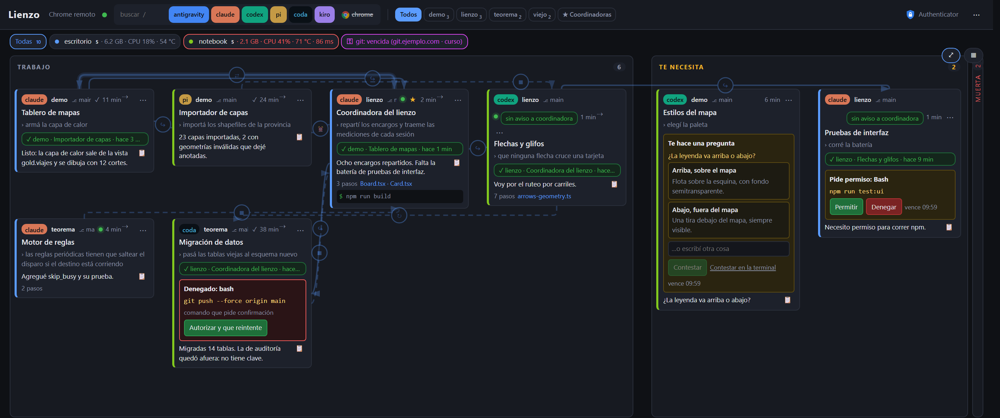
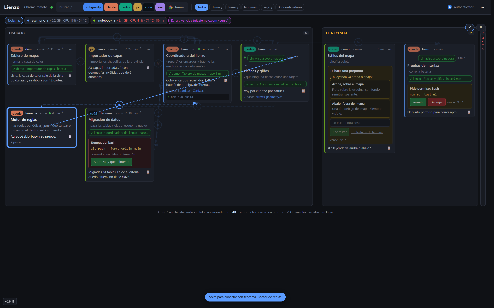
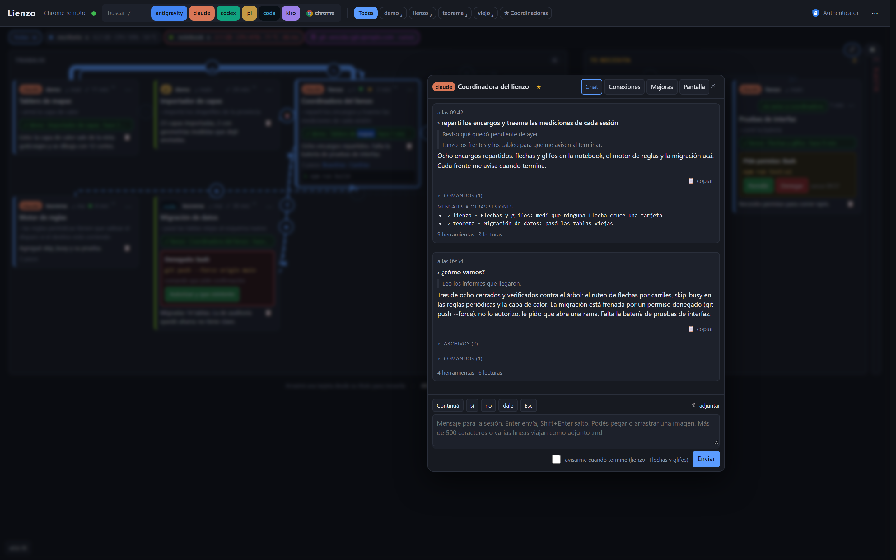
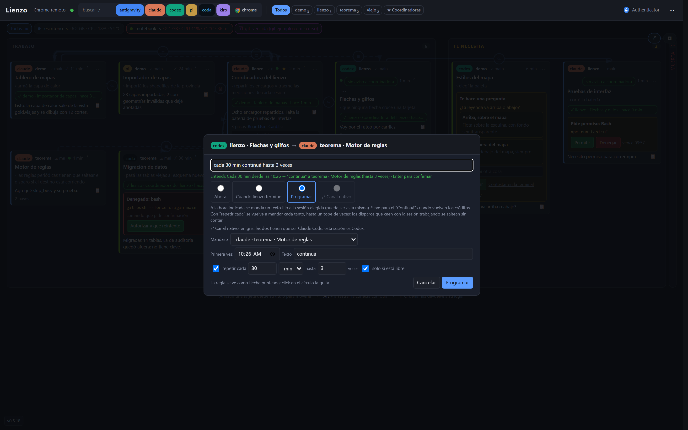
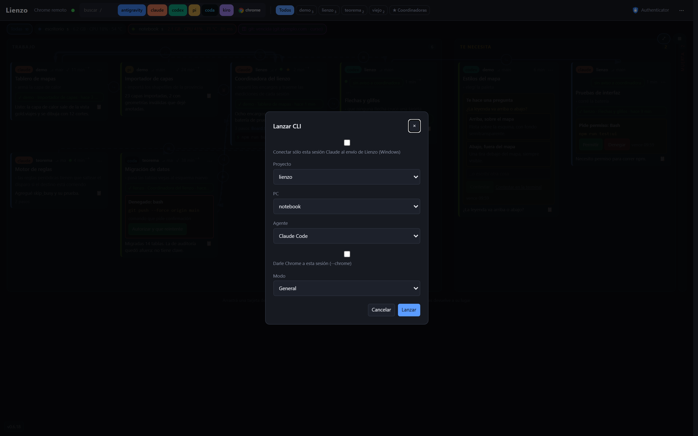
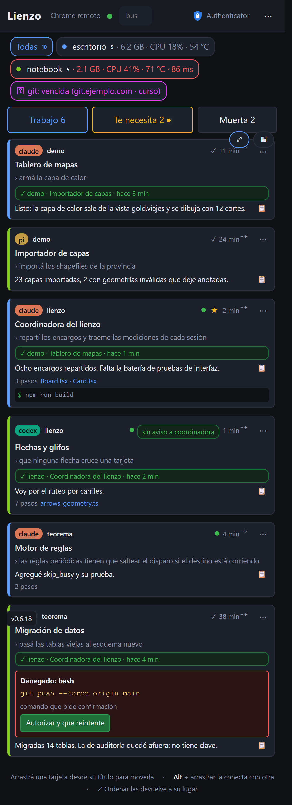
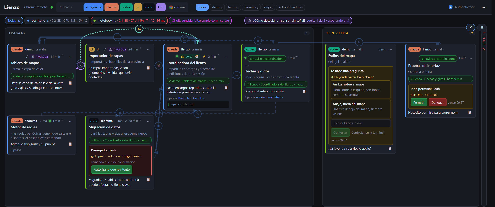

# Lienzo

Lienzo es una fábrica de software con agentes. Una coordinadora reparte trabajo entre sesiones
de Claude Code, Codex, coda y otros agentes, recibe sus informes y verifica lo producido. Las
sesiones pueden correr en una PC o repartirse entre hasta 4 PCs emparejadas de la misma LAN.
El tablero permite intervenir; el método organiza cómo se construye, se revisa y se aprende.

**Versión 0.6.18.** [Novedades, validación y límites](docs/releases/0.6.18.md).

[Instalación](#instalación) · [Coordinación](#la-coordinación-como-metodología) ·
[Meta-harness](#el-meta-harness) · [Aprendizaje](#ia-prolog-y-aprendizaje-continuo) ·
[Referencia operativa](#referencia-operativa) · [Limitaciones](#limitaciones-conocidas)

## Una fábrica de software

<picture>
  <source media="(prefers-color-scheme: dark)" srcset="docs/img/infografias/fabrica-dark.svg">
  
</picture>

La mesa representa el trabajo compartido. El puesto iluminado es la coordinadora; los demás,
frentes con un resultado y archivos a cargo. Las fichas ámbar son encargos y las verdes son
informes que vuelven. Los cajones conservan las rondas. Cada instrumento está rodeado por un
marco: el meta-harness que lo lanza, observa y conecta. La cantidad de puestos es ilustrativa.

Desde una tarjeta podés leer la conversación, mandar mensajes, adjuntar capturas y responder
permisos. También podés lanzar sesiones, conectar sus informes, copiar archivos y manejar el
Chrome de otra PC. Cada PC sigue siendo dueña de sus procesos, sus permisos y sus recursos.

Corre en `127.0.0.1:7321`. Lee el historial de cada agente y escribe en su terminal.
Las terminales y las transcripciones siguen a cargo de los agentes.

## La coordinación como metodología

Una ronda parte de un objetivo y lo divide en encargos verificables. La coordinadora sostiene
el contexto común y cada frente trabaja sobre su parte. El método se puede seguir desde los
propios agentes con el [skill de Lienzo](skills/lienzo/SKILL.md).

1. **Preparar.** Leer el estado del proyecto y los aprendizajes aplicables. Definir el resultado,
   el alcance y la evidencia que permitiría aceptarlo. Lienzo trabaja con
   [FDD](https://github.com/arielelevy/fdd), con documentación proporcional al trabajo.
2. **Repartir.** Escribir un encargo por frente: carpeta, insumos, archivos propios, restricciones
   y criterio de verificación. Los frentes de un mismo árbol no se pisan ni commitean por su cuenta.
3. **Coordinar.** Conectar cada frente con la coordinadora y el informe de vuelta. Las rondas
   largas usan avisos con acuse y turnos para recursos pesados. Los frentes no se contestan
   entre sí indefinidamente: la coordinadora decide el próximo paso.
4. **Verificar.** Leer el informe y contrastarlo contra el árbol: cambios reales, pruebas,
   revisión y pendientes. Que una sesión termine o diga «listo» no acredita el resultado.
5. **Dar veredicto.** Registrar qué se sostiene, qué se devuelve y qué sigue abierto, con evidencia
   y motivo. Integrar o cerrar requiere la decisión que corresponda; recibir un informe no la sustituye.

Rondas, encargos, informes y veredictos quedan vinculados en la memoria del proyecto. Así, la
ronda siguiente puede recuperar tanto una decisión como las razones y pruebas que la sostienen.

## El meta-harness

El harness de cada agente administra su conversación, herramientas y ejecución. Lienzo envuelve
esos harness con una capa común de coordinación. Claude Code, Codex y coda conservan su identidad
y sus capacidades; la cobertura depende de la integración de cada uno.

| Capa de Lienzo | Qué aporta al trabajo |
|---|---|
| Lanzamiento y continuidad | Elegir agente y PC, titular, retomar sesiones y conservar conexiones cuando hay una sucesora identificada. |
| Hooks y permisos | Observar estados, llevar pedidos al tablero y devolver decisiones al agente. |
| Cuotas y recursos | Consultar margen de uso, memoria y disponibilidad antes de abrir más frentes o investigar en segundo plano. |
| Mejoras de agentes | Aplicar las integraciones habilitadas al lanzar y mostrar su disponibilidad, costo y límites. |
| Contexto y controles | Llevar aprendizajes vigentes a las sesiones y frenar patrones concretos de comandos cuando hay un control activo. |

Al arrancar el servidor, Lienzo comprueba y aplica las actualizaciones de los harness instalados
(Claude Code, Codex, Pi, CODA y Kiro), usando sus comandos propios. Repite la comprobación cada
6 horas. Antes de iniciar o retomar una sesión, comprueba ese harness si venció el intervalo y
espera hasta 120 segundos. Un error queda en el log y como aviso del lanzamiento; la sesión puede
abrirse igual y la comprobación se reintenta tras 15 minutos. Las instalaciones de WSL se comprueban
al lanzar en esa distro y luego periódicamente. Las sesiones abiertas conservan su proceso original.

El detalle de [mejoras](#mejoras-de-agentes), [automatizaciones](#las-automatizaciones) e
[integraciones con límites](#antigravity-cli-windows) queda en la referencia operativa.

## IA, Prolog y aprendizaje continuo

<picture>
  <source media="(prefers-color-scheme: dark)" srcset="docs/img/infografias/aprendizaje-continuo-dark.svg">
  
</picture>

Las bandejas separan lo registrado de lo interpretado. La prensa representa el motor lógico;
el carril frontal, la vuelta de los aprendizajes al trabajo. La escalera **1 → 2 → 3 → creencias**
describe niveles de lectura: no obliga a convertir cada captura por todos los escalones.

| Nivel | Qué conserva y quién lo usa |
|---|---|
| **1 · Crudo** | Pedidos, respuestas y eventos capturados, con su procedencia. Permite volver a la fuente mientras se conserve; las transcripciones originales siguen en cada agente. |
| **2 · Cómo se hizo** | Actividad, tiempos, esperas y quién hizo qué. El investigador usa vistas acotadas y redactadas del proceso; no supone un registro exhaustivo de cada herramienta. |
| **3 · Qué se hizo** | Resultados, temas, decisiones, hallazgos y preguntas. Sirve para recuperar contexto y para consumidores externos, sin exponerles el crudo. |
| **4 · Creencias propuestas** | El investigador con IA propone cómo mejorar el trabajo, con fuentes, alcance, excepciones y límites. Una propuesta todavía no es una regla vigente. |

El [resumidor](lienzo/resumidor.py) trabaja en segundo plano sobre días cerrados de pedidos y
respuestas. Produce informes `resumen_nivel3`, conserva un cursor y declara los recortes de su
muestra. La depuración del crudo espera también ese cursor. El
[investigador de creencias](lienzo/research_creencias.py) lee novedades de memoria, evidencias,
reviews, coordinación y pruebas; distingue mejoras propias del proyecto de mejoras del proceso
de trabajar con Lienzo. También puede proponer formalizaciones de creencias existentes.

**La IA propone; Prolog hace explícitas las consecuencias de hechos y reglas formalizadas.**
El [ciclo lógico](lienzo/prolog_ciclo.py) tiene tres trabajos:

- **Contraste:** detectar apoyos caídos, contradicciones y premisas que dejaron de sostenerse.
- **Contraejemplos:** poner a prueba una generalización contra casos y condiciones registrados.
  No encontrar uno en esa muestra no demuestra una ley universal.
- **Deducción:** encadenar reglas formalizadas habilitadas para obtener conclusiones nuevas,
  conservando la prueba y sus premisas. Una creencia escrita sólo en prosa no alcanza para ese encadenamiento.

El motor separado requiere SWI-Prolog y `motor-logico`. Lienzo verifica sus pruebas y contrasta
con cálculos Python independientes donde corresponde. Un fallo o falta de contraste se informa;
no se presenta como respaldo. Las creencias y derivaciones requieren veredicto humano con
evidencia para adquirir vigencia. Si cae una premisa, la conclusión queda sujeta a revisión.

Lo aprendido vuelve por tres caminos:

- **Contexto de sesión.** [contexto_sesion.py](lienzo/contexto_sesion.py) proyecta principios de
  proceso y creencias vigentes del proyecto. Claude los recibe por `SessionStart`; los otros
  agentes que lanza Lienzo, por las instrucciones del lanzamiento.
- **Checklist del encargo.** La coordinadora consulta creencias aplicables y las incorpora al
  reparto. El checklist distingue lo sostenido, lo cuestionado y lo que no tiene contraste del motor.
- **Controles de comandos.** En Claude, `PreToolUse` de Bash aplica controles del catálogo
  activados por una creencia vigente. Hoy incluye frenar pruebas enviadas por pipe a comandos
  como `tail` o `tee` sin `pipefail`, porque podrían ocultar el código de salida de una falla.

El uso posterior también deja evidencia: si una creencia sirvió, no aplicó o ya era conocida.
Ese retorno permite revisar el aprendizaje. El [bot externo](lienzo/bot_externo.py) expone sólo
lecturas de nivel 3, con clave y selección de proyectos; usa un servidor separado del que controla
sesiones. El diseño y sus límites están en [Producto](docs/PRODUCTO.md),
[Aprendizaje](docs/APRENDIZAJE.md) y el [contrato de memoria](docs/propuesta-memoria/v5.md).

[Arquitectura, diseño y recorridos de los pedidos](https://arquitectura-lienzo.ariel-e-levy.chatgpt.site/) ·
[Pendientes y evidencia](PENDIENTES.md) · [Historial de mejoras](PENDIENTES.md#historial-mejoras) ·
[Documentación y decisiones de producto](docs/README.md)



## Cómo funciona

Cada sesión tiene una tarjeta con conversación, estado y acciones. Los agentes compatibles
incluyen Claude Code, Codex CLI, Pi CLI, CODA y Kiro V3; Antigravity tiene una integración parcial.

<details>
<summary>Canales del tablero, permisos y continuidad de las sesiones</summary>

<picture>
  <source media="(prefers-color-scheme: dark)" srcset="docs/img/infografias/central-dark.svg">
  
</picture>

El tablero funciona como una central de comunicaciones. Cada jack es una sesión y su lámpara muestra el estado.
Cada cordón es una conexión entre dos sesiones, también entre PCs. La lámpara resaltada es un
permiso esperando respuesta. En Claude Code, Codex y CODA, si nadie lo contesta en 60 s, vuelve
a la terminal.

<br clear="right">

Cada 30 s el server recorre los procesos de la PC y arma una tarjeta por cada agente que encuentra,
aunque se haya abierto antes de instalar nada (descarta las apps de escritorio y las extensiones de
VS Code). El estado, el contenido y los envíos usan estos canales:

| Qué | Cómo |
|---|---|
| Estado | Hooks en `~/.lienzo/events`, procesos y fuentes propias de cada agente. Algunos diálogos de permisos se reconocen en el buffer de consola. |
| Contenido | Las transcripciones que los agentes ya escriben (`.jsonl`; en CODA, su base local), leídas por la cola. |
| Mandar un mensaje | Los agentes de consola compatibles usan teclas por PID (`AttachConsole` + `WriteConsoleInputW`), sin foco. Codex CLI fija la encarnación del proceso y escribe en su consola visible, también después de `/new` o `/clear`. Codex Desktop usa su cola de hilo; Claude Desktop, el adaptador autorizado. La escritura espera confirmación del agente antes de figurar entregada. Lo largo puede viajar como `.md` adjunto. |
| Contestar un permiso | El hook `PermissionRequest` espera hasta 60 s la respuesta del tablero; si nadie contesta, el prompt aparece en la terminal como siempre. En CODA, Permitir y Denegar se teclean en su diálogo. |
| Contestar una pregunta | `AskUserQuestion` llega por el mismo hook; la opción elegida vuelve en la decisión. |

Kiro V3 en Windows usa su historial `~/.kiro/sessions/*/sess_*/messages.jsonl`, vinculado al PID
de su motor mediante el lock de sesión y el proceso CLI padre. Sus permisos y los de Codex se
muestran como diálogos en las tarjetas; se responden con flechas y Enter, verificando antes que el
pedido siga abierto. Kiro se lanza por su ruta instalada en `%LOCALAPPDATA%/Kiro-Cli` con `--v3` y
retoma por `--resume-id`. El rol de coordinadora requiere un canal de envío disponible.

Una consola que cambia de `session_id` sin cambiar de proceso (un `/clear`, un resume) le pasa sus
conexiones a la tarjeta nueva. Una tarjeta que muere deja estacionadas sus reglas, las suyas y las que
le avisaban, en `~/.lienzo/sucesion.json`. Sólo las hereda una sucesora real, junto con el título y
también después de reiniciar el server: la que retoma con el mismo id, la restaurada desde el lienzo
o una a la que el lienzo le pone el mismo título. Otra sesión cualquiera del mismo agente en la
carpeta ya no se las lleva. Una coordinadora reabierta a mano recupera sus avisos sólo si tenía
título y la nueva recibe el mismo.

Al pegar trabajo en otra tarjeta y detener la original, las reglas pendientes en ambas
direcciones pasan a la copia, junto con la marca de coordinadora. También funciona al copiar
una copycat. El historial de mensajes conserva sus extremos originales. Si una PC no responde
o el traslado crearía un bucle de informes, aparece un error de traspaso; el texto ya enviado no
se reenvía. «Duplicar» conserva a la original trabajando y agrega el informe de vuelta.

</details>

## Requisitos

- Windows 10/11 (probado de punta a punta). Mac, Linux y WSL van por tmux, ver [Mac, Linux y WSL](#mac-linux-y-wsl).
- Python 3.14+, sólo biblioteca estándar.
- Node 24 LTS para compilar la interfaz.
- Claude Code 2.1+, Codex CLI 0.153+, Pi CLI 0.86+, CODA o Kiro V3 (Windows).
- `cloudflared`, sólo para el acceso desde el celular.

## Instalación

```powershell
git clone https://github.com/arielelevy/lienzo
cd lienzo\web; npm install; npm run build; cd ..
py -3.14 install.py        # hooks de Claude/Codex/CODA y la extensión Pi (--pi-only, --coda-only)
.\lienzo-server.cmd        # http://127.0.0.1:7321
```

`install.py` hace merge y no pisa tu configuración; `--uninstall` saca los hooks. El estado vive en
`%USERPROFILE%\.lienzo\`. Codex pide confiar cada hook la primera vez. En Pi, `/reload` carga la
extensión; en CODA, `/reload-hooks`.

Los atajos `lienzo-server.cmd` y `lienzo-server.sh` ejecutan `git pull --ff-only` al arrancar.
Si cambió `web/`, compilan la interfaz. Un pull rechazado avisa y usa la versión local;
un error de compilación detiene el arranque. Los reinicios internos no repiten el pull en Windows.

**Después de un `git pull`, reiniciar.** El server sigue con el código viejo hasta `POST /restart`
(o `coordinar.reiniciar()`; con `pc`, reinicia otra PC). Comprueba que el código compile, sale con
75 y `lienzo-server.cmd` lo relanza en la misma ventana; si algo no compila, contesta 409 y sigue
con lo viejo. Si cambió algo de `web/`, antes `npm run build`: `web/dist` no viaja con git.
`"auto_reload": true` en `config.json` lo reinicia solo con cada `.py` (apagado: cortaba el trabajo
de los agentes).

<details>
<summary>Instalación y límites en Mac, Linux y WSL</summary>

### Mac, Linux y WSL

Lo atado a Win32 son dos piezas: escribir en la consola de otro proceso y leer su buffer. Fuera de
Windows van por tmux (`send-keys`, `capture-pane`). Un tablero en Windows ve también los agentes de
WSL y les escribe por `wsl.exe`.

Para escribirle a un agente, tiene que haber nacido adentro de tmux (en Unix un PTY es de quien lo
creó). Leerlo no lo necesita: uno abierto suelto aparece en solo lectura. `./lienzo-new.sh claude`
abre uno en tmux, y `POST /sessions/launch` en Mac/Linux/WSL siempre usa tmux. El server arranca con
`./lienzo-server.sh`. Probado: un tablero de Windows manejando agentes en tmux de WSL.

Probado el 2026-10-22: el server nativo en Linux (Ubuntu de WSL, Python 3.14, con su propio
`~/.lienzo`) emparejado con una instancia de Windows, con salud, latencia y espejo en los dos
sentidos, y el hook de un Claude en tmux que manda `TMUX_PANE` como destino de lo que se teclea.
En el camino se arreglaron tres cosas: `--peer-port` es también el puerto que se anuncia al
emparejar, una IP de origen de beacon detrás de NAT se sondea antes de mover el espejo a ella (con
WSL en red NAT los beacons llegan desde la puerta del NAT), y en Linux la CPU se lee de
`/proc/stat`. Un Mac sigue sin probar. Lienzo no usa `TIOCSTI` (apagado en los kernels modernos
por seguridad).

</details>

## Referencia operativa

El detalle queda desplegable para que la primera lectura se concentre en el método. No se pierde
la referencia de comandos, las mediciones históricas ni sus límites.

[Tablero y mejoras](#uso) · [Delegar](#delegar-trabajo-a-varias-sesiones) ·
[Celular](#acceso-desde-el-celular) · [Varias PCs](#varias-pcs) ·
[Investigación](#lienzo-en-la-investigación-científica) · [API](#api)

<details>
<summary>Uso del tablero, mejoras, automatizaciones, Chrome, memoria y plugins</summary>

## Uso

### Tablero

Tres columnas: Trabajo (corriendo y terminó), Te necesita (pide permiso, pregunta o está
libre) y Muerta. Una muerta que se puede revivir (no cerrada a propósito) queda 2 minutos: «↻ Revivir»
en su menú la relanza con su conversación, título y reglas, y el click derecho en la columna Muerta
ofrece «Revivir todas», con la memoria de cada PC como tope. Las demás se borran al minuto.
`/` busca; los chips filtran por agente, PC y proyecto (Ctrl+click suma varios).
Click en una tarjeta la elige y resalta sus conexiones; doble click abre el panel (pestañas *Chat*,
*Pantalla* y *Conexiones*); Esc cierra de a una capa. Las tarjetas se pueden arrastrar desde su
título a otro lugar (⤢ Ordenar las devuelve); con Alt, el arrastre conecta con otra tarjeta. Las
posiciones y los filtros viven en el navegador.

Desde 0.6.8 todo se ve a ~81 %, con los estilos reescalados sin `zoom`: las líneas de 1–2 px, los
blancos de clic de 24 y 44 px y la vista de celular quedan iguales. Las tarjetas tienen 10 % más de
separación y el título «Lienzo» es más grande. Las tarjetas de las extensiones de Chrome (Claude y
Codex) arrancan ocultas; el chip «chrome» las muestra.

Un nombre de proyecto de más de 24 caracteres se corta al medio con «…» en el título de la tarjeta
y en los chips de proyecto: queda el principio y el final, que es lo que distingue
«cliente-proyecto-…-2026» de su vecino. El nombre entero sigue en el tooltip del chip.



Ctrl+click arma una selección múltiple: Enviar a todas, Interrumpir (un Esc a cada una) o
Marcar las visibles.

### La tarjeta

Título (✎ para renombrar), último pedido, lo que el agente viene escribiendo en este turno, pasos,
errores, archivos tocados, último comando y la sugerencia 💡 de la terminal. La ★ marca la
coordinadora del repo: es a quien van los avisos «cuando termine». Según el caso aparecen
«Continuar a las HH:MM» (límite de uso) o «↻ Reintentar» (error de API). Los menús numerados de la
TUI («Switch model?») se muestran con sus opciones y se eligen desde ahí.

Una tarjeta en «corriendo» cuya pantalla no cambia hace N minutos (sin contar spinners ni segundos)
muestra «pantalla quieta · N min» hasta que cambie: puede estar colgada. Son 5 minutos por defecto;
el menú ⋯ de la tarjeta los cambia (3, 5, 10, 15, 30 o sin aviso) para todas, y la elección vive
en el navegador.

Un `claude -p` corriendo en el mismo repo ya no marca como headless la tarjeta de una TUI viva. El
barrido adivinaba la transcripción de un proceso sin hooks como la más nueva de la carpeta, y así
la marca del proceso batch pasaba a la tarjeta interactiva, que después rechazaba los envíos con
409. Una transcripción adivinada que pertenece a otra sesión viva, con otro PID, ya no toca esa
tarjeta.

### Contestar, aprobar, adjuntar



- Contestar: la caja del panel; se escribe en su terminal aunque esté oculta. Tab escribe la
  sugerencia que muestra la terminal.
  En Codex CLI sobre Windows, el envío espera a que la consola consuma el texto y deja una pausa
  antes del Enter para que el mensaje se publique. Si la cola no se vacía en 10 s, informa el error.
  Si Codex usa un daemon compartido y la terminal no tiene abierto su rollout, Lienzo consulta
  `/status` automáticamente cuando el editor está vacío y la terminal libre. El UUID publicado
  por esa TUI permite encontrar su transcripción exacta y unir la tarjeta provisional con la de
  los hooks. Teclea `/status` una vez por proceso, y otra cada vez que el proceso abre un rollout
  que el último `/status` no vio (tras `/new` o `/clear` y su primer turno); no ejecuta un turno
  del modelo. Con un borrador, un diálogo o trabajo en curso, espera y reintenta cada 15 s como
  mucho. Tras `/new` o `/clear` Codex deja abierto el rollout viejo: la tarjeta sigue al hilo nuevo
  por el nombre único de su pie, que se lee en UTF-8. Verificado con un Codex real: la tarjeta pasó
  al hilo nuevo con el mismo PID, y en siete chequeos ociosos no tecleó nada. El vínculo es de
  lectura: los mensajes siguen entrando por la consola, sin habilitar la cola CLI.
- Permisos: Permitir o Denegar desde la tarjeta (nunca «permitir siempre»; vence a los 60 s).
  Los de Antigravity se contestan en su terminal o, con Auto-aprobar TODO prendido, los contesta el
  lienzo (ver [Las automatizaciones](#las-automatizaciones)).
- Denegados: lo que una regla, política o clasificador le niega al agente aparece como
  «Denegado: herramienta» con un botón «Autorizar y que reintente». Una denegación anterior al
  pedido en curso no vuelve a aparecer.
- Preguntas con opciones: se elige en la tarjeta, sin pasar por la terminal.
- Adjuntos: arrastrar a la caja o pegar una captura con Ctrl+V.
- «avisarme cuando termine»: manda el texto y crea la regla hacia la coordinadora.
- Copiar y pegar trabajo: Ctrl+C en una tarjeta arma un encargo con su último pedido, respuesta y
  destacados; Ctrl+V en otra lo manda. La destino hereda el título (⧉ copycat) y la de origen recibe
  un Esc y queda stopped, salvo con Duplicar.
- Stopped: la etiqueta roja. Mientras está prendida la sesión no recibe nada (envíos, reglas,
  pegados) y el lienzo avisa a la coordinadora y a sus conexiones. Se apaga con un click o sola con un
  pedido nuevo por su terminal.

### Conectar sesiones

Arrastrar una tarjeta desde ⇢ (o con Alt) y soltarla sobre otra; se escribe en una frase que se
interpreta al tipear: «continuá a las 16:00», «cada 30 min continuá hasta 6 veces», «cuando termine
mandale a demo». Modos: *Ahora*, *Cuando termine*, *Programar* (a una hora o cada tanto, con tope) y
*Canal nativo* (Claude a Claude, `SendMessage`). Toda regla tiene tope; el server rechaza el bucle
A↔B, la regla repetida y dos programadas al mismo minuto hacia la misma sesión. Cada conexión se
dibuja como flecha (las de envío viven 10 minutos).

Una regla «cuando termine» no vuelve a entregar el mismo turno: la misma respuesta al mismo pedido,
ya entregada o en espera (`dedupe`, prendido por defecto). El mismo «Listo.» a otra tarea sí avisa. Con
`solo_si: "ESTADO:"`, o cualquier marcador de hasta 64 caracteres, sólo avisa los turnos cuya
respuesta lo trae. El marcador se busca en la respuesta entera, aunque `{respuesta}` lleve los
primeros 6000 caracteres. Los intermedios quedan como «salteado» en la regla y en el log. Los avisos demorados por el límite de frecuencia
salen juntos con la respuesta del último turno que pasó el filtro.



### Lanzar una CLI

Un clic derecho en el área libre del tablero abre «Lanzar CLI»: elegís el proyecto, la PC y el
agente (Claude Code, Codex, Pi, CODA o Kiro). El selector de proyecto lista arriba las carpetas
de la PC elegida: primero las que tienen una sesión abierta ahora y después las permitidas
(`launch_roots` de su `config.json`). Abajo, grisadas y sin repetir las de arriba, van las usadas
en los últimos 14 días que recuerda el server (`~/.lienzo/recientes.json`, `GET /recientes`), con
«hoy», «ayer» o «hace N días». Al final van los proyectos que solo conocen otras PCs, a los que hay
que indicarles la carpeta. El Lienzo de la PC
elegida lanza el proceso en una terminal nueva, sin exigir una sesión activa previa, y la tarjeta
aparece sola. «Otra carpeta…» abre un proyecto nuevo dentro de las carpetas permitidas.

Una sesión lanzada en la raíz de un disco (`D:\`) no tiene nombre de carpeta: su proyecto se
muestra con la ruta, cortada a 20 caracteres, en vez de «?». «?» queda sólo cuando no se conoce
ninguna carpeta. Las tarjetas guardadas con «?» se recalculan desde su carpeta al cargar el server.

En Windows el lanzamiento escribe `~/.lienzo/launch/<token>.cmd` y, al lado, `<token>.json` con el
título pedido y el agente. La tarjeta nueva lo encuentra subiendo por los padres de su PID hasta el
`cmd.exe` de ese `.cmd`, y toma ese título salvo que ya tenga uno puesto a mano. Un `.cmd` de otra
carpeta, otro agente o un `.json` roto no titulan nada. Antes, la tarjeta salía como «sesión sin
transcripción identificada» o con el primer pedido, y el título sólo llegaba a la ventana. Cada
lanzamiento borra los `.cmd` y `.json` propios (nombre de 12 hex) de más de 7 días, nunca el que
está en uso ni archivos con otro nombre; lo que no se puede borrar se saltea.



### Mejoras de agentes

Clic derecho en el área libre → **Mejoras de agentes** abre una vista de pantalla completa: a la
izquierda las integraciones (las que se prenden al lanzar, con su interruptor), a la derecha el
aprendizaje en segundo plano, con su estado, presupuesto y trabajos. Configura esta PC para nuevos
lanzamientos. El perfil de respuestas breves se inspira en [Caveman](https://github.com/JuliusBrussee/caveman):
mantiene idioma, comandos, errores y pruebas; no instala su proxy ni comprime archivos. La preferencia
**RTK** añade instrucciones para usar [RTK](https://github.com/rtk-ai/rtk) explícitamente en comandos
compatibles: compacta lecturas, búsquedas y salidas largas, no sólo estas últimas. No modifica
hooks, permisos ni `AGENTS.md`. Los agentes ya abiertos conservan su contexto.

El panel de una sesión tiene **Mejoras**: muestra una ventana de turnos, recuentos y sugerencias con
referencias. Leer mucho código o recibir texto largo no demuestra desperdicio. El consumo se conserva
según la fuente, sin sumar contadores acumulados como si fueran consumo por turno. La calidad del
trabajo permanece sin evaluar hasta tener validación funcional.

<picture>
  <source media="(prefers-color-scheme: dark)" srcset="docs/img/infografias/jev-dark.svg">
  
</picture>

**Consultar Jev** envía solamente la muestra visible de métricas y referencias, tras autorizar una
consulta paga. No envía prompts, argumentos, resultados de herramientas ni credenciales. El cliente
usa OpenRouter Decisions, modelo `typesafe/jev-1.13`, sin reintentos y con proveedor ZDR/sin recolección.
Una estimación no habilita gasto: antes de enviar se reserva el máximo de la cotización (tope
USD 0,002688). El ledger conserva reservas y costos informados; un cargo sin cota y un proveedor sin
máximo comprobable bloquean solicitudes nuevas, y un cargo desconocido pero acotado queda reservado.
El piloto del scheduler, si está habilitado, consulta solo dentro de su ventana y su tope de
intentos, con su propia muestra. La clave de OpenRouter viaja sólo como autorización del pedido.
Jev propone una herramienta o datos insuficientes: no instala, aprueba ni ejecuta acciones.

<picture>
  <source media="(prefers-color-scheme: dark)" srcset="docs/img/infografias/scheduler-dark.svg">
  
</picture>

El scheduler analiza incidentes nuevos de la memoria cuando hay 180 segundos de inactividad,
dos muestras de recursos aptas y ningún agente ocupado ni permiso vigente. Encola automáticamente
por proyecto y versión de fuentes, con cooldown de 120 segundos y hasta 100 trabajos; sus propias
hipótesis no generan otra ronda. Las hipótesis quedan propuestas, con evidencia y veredicto pendiente.

**Qué agente investiga.** El investigador usa Codex mientras le quede al menos 20 % del cupo
semanal. Si no, o si Codex queda bloqueado por otro motivo, usa Claude con la suscripción, en sólo
lectura (`claude -p` con `Read`, `Grep` y `Glob`, sin hooks ni persistencia de sesión) y sin
`ANTHROPIC_API_KEY` en el proceso hijo, así que no factura por API y no aparece como tarjeta en el
tablero. La cuota de Claude se lee antes de empezar y cada 5 minutos durante la corrida (semanal
hasta 80 %, ventana de 5 h por debajo de 90 %). El panel muestra qué adaptador se eligió y por qué.
Una corrida real sobre un caso de lienzo tardó 59 s y dejó una evidencia y tres propuestas que
esperan veredicto. El techo de 6 corridas por día es de todo el investigador; el tope de cada
autorización se cuenta por adaptador.

**Azure, sólo a pedido.** El adaptador `azure-openai` (deployment `gpt-6.1-sol`) nunca se elige
solo: se pide por trabajo con «Revisar con Azure» o «Encolar con Azure», y sólo para proyectos
propios (lienzo, motor-logico, opensyync, pruebas-agenticas, chess y teorema) con todas sus
carpetas bajo `D:/Apps`. Un proyecto de la regla de coda-dgx no va a ningún otro adaptador. Hace
una llamada a la Responses API sin herramientas, desde `research_azure_call.py` con `python -I`,
sólo por https a hosts de Azure. El ledger (`~/.lienzo/research-ledger.sqlite`) reserva el peor
caso antes de cada llamada (bytes del prompt y del esquema como tokens de entrada más 16.000 de
salida, a USD 5 y 15 por millón), liquida con el uso que informa Azure y corta en seco a USD 5 por
mes calendario UTC. Además: USD 1,5 por ejecución, 4 ejecuciones por día y 300 s cada una. Sin uso
informado después de enviar, la reserva queda entera como cargo desconocido; si no se envió nada,
se liquida en cero. La key va al almacén DPAPI con `py ops/importar-azure.py` (usa `az` con
`--subscription` y no imprime la key); hasta cargarla, Azure queda bloqueado y el panel lo dice.
Todavía no se hizo ninguna llamada paga: se probó con una key sintética y un doble HTTP local.

Una investigación interrumpida por actividad, memoria o cuota espera 30 minutos antes de volver
a intentarlo; los intentos ya usados siguen contando. Una pausa manual no agrega esa espera.
La revisión permite reencolar o descartar por decisión explícita, conservando intentos, corridas
e historial y revalidando la política. Cancelar se persiste antes de confirmarlo: una evaluación
de cuota pendiente no puede volver a arrancar el caso y la cancelación sobrevive a un reinicio.
Un proceso interrumpido al reiniciar pasa a revisión, salvo que ya tuviera cancelación solicitada.
El PID anterior se conserva como referencia en el motivo; Lienzo no intenta matarlo.

En esos mismos ratos quietos mide también **cómo se trabaja** (`lienzo/optimizacion_trabajo.py`, pedido
de Ariel del 2026-10-16). A lo sumo una vez por hora por proyecto lee las capturas de las últimas 72 h:
pedidos, respuestas, envíos y disparos de reglas. Mide frentes que ya entregaron y esperan a una
coordinadora ocupada, acuses que vuelven como aviso, avisos repetidos o intermedios, el mismo texto
mandado a varios frentes y el pico de sesiones (este último sólo se informa). Lo que pasa su umbral queda como un `hallazgo`
propuesto, uno por métrica y día, con el número, capturas de ejemplo y la primitiva que lo ataca; el
beneficio no está medido y requiere veredicto. No manda mensajes ni gasta. `GET /trabajo/<proyecto>`
(o `coordinar.trabajo`) muestra el análisis en el momento, sin escribir. Un hallazgo que una coordinadora
o una persona da por `corregido`, con un vínculo `corregido_en` a una evidencia con `datos.desde`, se
vuelve a medir sólo desde esa fecha. Si después vuelve a pasar el umbral, aparece un hallazgo nuevo
«Reaparece después de…», vinculado `mismo_que` al resuelto; reabrirlo es un veredicto. Medido en OpenSyync (13 al 16
de octubre): 92,8 h de frentes esperando, 4 acuses sin tarea que volvieron como aviso, 46 avisos repetidos, 118 intermedios,
20 difusiones; el pico fue de 13 sesiones.
Los permisos vencidos o de sesiones muertas se conservan en el historial sin bloquear este trabajo.

**Comparar RTK cuando esté libre** encola dos perfiles de contratos locales, sin modelos ni gasto de
servicios. Comprueba fuentes congeladas, conserva códigos/salidas/tiempos y pausa entre perfiles;
no mide por sí solo ahorro de tokens ni calidad de agentes. El presupuesto de esta ronda es USD 2
totales, incluidos costos previos; es la autorización histórica del piloto, no un presupuesto nuevo.
El piloto Jev, si está habilitado, sigue sus condiciones; los coding agents automáticos permanecen
deshabilitados. El contrato consolidado y las propuestas de evolución están en [Aprendizaje](docs/APRENDIZAJE.md).

Los títulos de tarjeta y consola usan `proyecto | tarea`, con el proyecto en minúscula. Lienzo aplica
el título al detectar un proceso o cambiar PID/tarea; no vuelve a escribirlo si esos datos no cambian.
Los lanzamientos y resumes de Codex desactivan su actualización propia de títulos y sus notificaciones
sonoras mediante overrides por invocación. Los permisos siguen visibles en el tablero.

Preparación explícita en Windows x64:

```powershell
py ops/preparar-mejoras.py
py ops/importar-jev.py --distro Ubuntu
```

El primero instala RTK 0.51.0 con SHA-256 publicado y habilita las dos preferencias; no instala hooks.
El segundo importa únicamente la clave OpenRouter de `/etc/chesstudia/nube.env` de Chesstudia a DPAPI
del usuario, sin mostrarla. No ejecutarlo en una instalación que no tenga ese origen autorizado.
La credencial queda bajo `LIENZO_HOME/private`; nunca en `config.json`, Git o navegador. En POSIX el
almacenamiento exige permisos 0600. WSL necesita su propio RTK: una instalación Windows no acredita
disponibilidad en una distro. Falta de RTK o instrucciones incompatibles se informa sin impedir lanzar.

`py ops/probar-mejoras.py --rtk` comprueba códigos de salida y recuperación sin compresión con datos
sintéticos. `--jev` hace una llamada paga para comprobar conectividad, no calidad del clasificador.

El catálogo de integraciones vive en `lienzo/tools/` y se consulta con `GET /tools`.
El panel muestra origen, versión declarada, costo y disponibilidad local.
RTK y respuestas breves son mejoras opcionales de los agentes. Jev evalúa, las pruebas agénticas
verifican código y REA sirve para trabajos de ingeniería reversa.
El modo «Ingeniería reversa» suma REA si está instalada y conserva las mejoras habilitadas.
La instalación de REA en Windows no acredita disponibilidad en WSL: se informa esa limitación.
El catálogo no instala herramientas ni autoriza consultas pagas.
La ampliación del catálogo y la distinción entre tools, plugins, integraciones y formas de trabajo
están en [Producto](docs/PRODUCTO.md) y [Plugins](docs/PLUGINS.md).

Lo mismo por API: `POST /sessions/launch {pc?, cwd, agent, title?, model?, modo?}`, o
`coordinar.lanzar_y_titular(...)` desde una coordinadora.

### Las automatizaciones

**Kiro (0.6.11):** una tarjeta por sesión (el ayudante `windows-kas-process` no cuenta); pasa a «te necesita»
cuando termina con una pregunta; el auto-aprobar contesta también el cartel de permisos de sus subagentes con
«(f) Approve all pending and auto-approve future subagent requests», así no vuelve a preguntar (si no está, «(a)»). Para cualquier agente, la tarjeta muestra lo último que el auto-aprobar
contestó en el turno en curso.

En el menú ⋯, apagadas por defecto:

- Continuar solo tras límite de uso: programa «Continuar» un minuto después de la hora de vuelta.
- Reintentar solo tras un error de API: «Continuar» diez segundos después.
- ☠ Auto-aprobar TODO: aprueba sin mirar cada permiso de cualquier agente, **en todas las PCs
  emparejadas**. Se prende sin cuadro de confirmación. Mientras está prendido, una pestaña negra
  cuelga del encabezado, a la izquierda de Authenticator, con Apagar; cada aprobación queda en
  `lienzo.log`.
  Sólo desde la LAN. Contesta los permisos que llegan por hook (Claude Code, Codex, Pi), el cartel
  de coda y, desde el 2026-10-08, el permiso que la TUI dibuja como diálogo de opciones sin hook
  («Would you like to run the following command?» de Codex, «Do you want to proceed?» de Claude):
  elige la opción que permite según cómo redacta cada TUI (su perfil en `agentes.py`; Kiro va con
  Allow/Deny). En Antigravity contesta crear o editar un archivo, correr un comando (también cuando
  el comando es largo, el encabezado «Requesting permission for:» quedó fuera de pantalla y las
  opciones ocupan varias líneas: alcanza el «Run this command?» visible) y el acceso a un archivo
  fuera del workspace. En este último elige «Yes, allow access», sólo esta vez y sólo si está la
  opción de negar; nunca la que lo deja permanente. No contesta una pregunta de verdad, el cambio de modelo ni la confianza en una
  carpeta, y en ese caso la tarjeta dice por qué («auto-aprobar no lo contesta: …»). No cubre lo que
  el agente se deniega solo (por ejemplo, los «comandos que piden confirmación» de coda, o lo que
  frena el clasificador del auto mode de Claude Code). La prueba real está en
  `pruebas-agenticas/e2e_autoaprobar.py` (lanza un Codex, gasta un turno).

### Chrome remoto

[Modos, descargas, configuración, transporte y mediciones de Chrome remoto](docs/chrome-remoto.md).

### Memoria por proyecto

<picture>
  <source media="(prefers-color-scheme: dark)" srcset="docs/img/infografias/memoria-dark.svg">
  
</picture>

El menú ⋯ → Memoria permite elegir un proyecto y consultar su briefing, buscar candidatos,
leer una vista por tema, y ver pendientes y avisos. Las consultas son de lectura; no confirman
hallazgos ni aceptan reglas automáticamente.

**La actividad de los agentes con turnos identificados queda en la memoria, sin registrar nada a mano**
(pedido de Ariel del 2026-10-09). Un historial parcial, como el lector inicial de Antigravity,
no confirma respuestas finales ni dispara esa captura automáticamente.
El proyecto es la carpeta: la primera vez que el lienzo ve una sesión en una
carpeta (hook, barrido, lanzamiento o envío) crea el proyecto de esa carpeta (la raíz del repo, y la
del repo principal para un worktree) y la sesión queda como nodo. El remote sólo une la misma
carpeta en dos PCs; dos carpetas de una PC nunca se juntan. Cada pedido, respuesta final, envío entre
sesiones y disparo de regla queda como captura `observado` con sesión, agente, modelo, PC y hora; una
respuesta final con bloque `conocimiento` es además un informe y se incorpora igual que una entrega
(si la sesión trabaja un encargo enviado, lo entrega como su revisión siguiente). Nada capturado pasa
a `vigente`. No se guardan adjuntos (sólo su nombre), ni secretos con forma conocida (se tapan), ni
las carpetas temporales del sistema; cada captura guarda hasta 64 KB con el hash del original.
`coordinar.proyecto(...)` queda para ponerle nombre o alias. Las rondas explícitas siguen para
agrupar, pero no hacen falta para que algo quede.

Cada proyecto tiene identidad propia, rondas, encargos e informes con hash y revisión. El
bloque JSON `conocimiento` del informe se valida entero antes de incorporarse al grafo. Los
veredictos requieren una coordinadora o una persona y conservan revisión, evidencia y motivo.
El cierre de ronda aplica sus veredictos y pendientes explícitos en una transacción.
Si un veredicto confirma una recurrencia, las reglas afectadas se cuestionan en esa misma
transacción, antes del cierre; un fallo revierte el conjunto. Una entrega asigna su revisión y
actualiza el encargo en una sola transacción. Cerrar o revivir una sesión actualiza sus nodos
en todos los proyectos en los que trabajó, conservando separados los incidentes de cada proyecto.

La recuperación combina archivos y temas, BM25 y relaciones del grafo. `preguntar` devuelve
candidatos paginados con sus referencias; una búsqueda vacía no prueba que algo no exista.
Las consultas comparten un máximo de 30 semillas por palabras, ordenadas por su mejor puesto;
no se comparan puntajes BM25 entre consultas distintas. Buscar muestra las usadas y encontradas
y avisa cuando hubo corte. Una base indisponible responde 503; una consulta FTS inválida, 400.
La paginación conserva una foto de IDs y orden durante 10 minutos mediante un token.
Los detalles se leen actualizados y se avisa si cambiaron; un token vencido responde 410.
Sin token, cada página recalcula los resultados. Si la foto supera los límites, se pide refinar la búsqueda.
Con `prosa=True` suma, aparte y marcado «prosa, no declarado», lo escrito en encargos, informes y
capturas que coincide; sin ese parámetro la respuesta no cambia. El texto con U+FFFD o mojibake
(UTF-8 leído como Windows-1252) se rechaza al entregar, al declarar un nodo y en el bloque, con la
línea y la columna; `reparar_texto` repara el mojibake guardado con un cambio auditado por nodo.
El aprendizaje cuenta episodios de recurrencia una vez, cuestiona reglas ante episodios
posteriores a su vigencia y muestra apoyos rechazados y dependencias.

**Contraste lógico de candidatos.** En Memoria → Aprendizaje, **Contrastar candidatos**
consulta el motor lógico separado por su contrato 3, sin almacén. Envía hechos del grafo sin
textos y reglas de Lienzo; devuelve respaldos caídos, reglas cuestionadas, oposiciones y apoyos
retirados, con pruebas que se verifican contra esas reglas y hechos. Un cálculo Python
independiente contrasta las conclusiones; si difieren o la prueba está recortada, no se informa
que el candidato esté listo para revisión. No promueve, rechaza ni cierra conocimiento.
El motor requiere SWI-Prolog (Ubuntu WSL en Windows) y el repo `motor-logico` junto a Lienzo,
o una ruta explícita en `LIENZO_PROLOG_ENGINE`. Su ausencia o una respuesta inválida se informa
como error. La procedencia humana se basa en el autor declarado en la memoria: todavía no hay
una credencial humana separada que certifique esa identidad.

**Creencias y checklist.** Una creencia es una decisión propuesta sobre cómo trabajar en el
proyecto; sólo un veredicto de una persona con evidencia la vuelve vigente. La pestaña Aprendizaje
abre con «Creencias del proyecto» y el estado de cada una, y explica en una línea para qué sirve.
Al abrirla lee sola: completa el contexto de trabajo con el encargo de la tarjeta elegida, o con el
encargo en curso (`GET /conocimiento/<p>/contexto-sugerido`, sólo lee), sin pisar lo que la persona
ya escribió o consultó. El checklist lista sólo las creencias que el motor lógico (contrato 3)
sostiene, con su prueba, y marca como cuestionadas las que el motor objeta o donde su lectura y el
cálculo Python independiente no coinciden. Sin motor, cada ítem dice que no tiene contraste, nunca
que el motor lo sostiene. Crear un encargo no espera a que arranque WSL: con el motor dormido, el
checklist del encargo va «sin contraste del motor lógico». Un chip en el encabezado resume el
aprendizaje de cada proyecto y abre su memoria.

**Etapas por encargo.** Cada encargo recorre pendiente → implementación → revisión → verificación →
aprobado, en la pestaña «Etapas» de la memoria, con la evidencia y el historial por ronda. El
server sólo lo pasa a revisión cuando llega un informe nuevo: un turno cerrado o la respuesta del
agente no aprueban nada. Pasar a verificación, aprobar o devolver a implementación es de la
coordinadora o de una persona con nombre (los demás reciben 403). Cada avance cita evidencia del
proyecto recibida en la etapa que deja, y devolver exige motivo. Después de una devolución, sólo
un informe con revisión nueva lo vuelve a revisión.

**Depuración del crudo.** Un hilo del server borra una vez por día lo crudo de más de 30 días:
capturas de la memoria (conservando el `rowid` más alto, para que los cursores de réplica sigan
valiendo), líneas viejas de `lienzo.log` y `.tmp` huérfanos de los hooks. Las transcripciones de
las CLI y los adjuntos no se tocan. Cada parte corre aunque otra falle. La primera corrida real
recortó `lienzo.log` en 4040 líneas; una simulación a 7 días sobre una copia borró 5641 capturas
en 1,96 s.

Las funciones de `skills/lienzo/coordinar.py` incluyen `briefing`, `preguntar`, `vista`,
`veredicto`, `cerrar_ronda`, `pendientes_memoria`, `recurrencia`, `cuestionar` y `lecciones`.
`preparar_encargo` agrega el briefing actual y la plantilla de conocimiento al texto de un frente.
La memoria es **una base SQLite por instancia del lienzo** (`~/.lienzo/conocimiento.sqlite`), con el proyecto
como una dimensión de cada tabla; los cuerpos de encargos e informes y la evidencia quedan como archivos en
`~/.lienzo/proyectos/<proyecto>/`. Se replica entre las PCs
emparejadas por el canal firmado (cada 120 s, o `POST /conocimiento/replicar`): cada PC trae de las
demás los cambios nacidos allá, los proyectos se unen por remote, y los choques y duplicados quedan
para la coordinadora ([anexo C](docs/propuesta-memoria/anexo-c-replica.md)). Cada vuelta empieza
con un solo pedido `marcas`, que dice por proyecto hasta dónde llegan los cambios y capturas del par,
y sólo se pide lo que pasa el cursor local. Una vuelta ociosa bajó de 41 pedidos y 494 ms de CPU a
1 pedido y 19 ms. Un par de la versión anterior contesta 400 a `marcas`: se sigue con el ciclo viejo
por proyecto y se reintenta a los 15 minutos. Las bases no se suben a Git.

Las bases viejas por proyecto se reimportan con procedencia: cada nodo y vínculo anota de qué base y
revisión vino y una huella. Una reimportación actualiza lo que cambió allá y no acá (CAS contra esa
huella), no hace nada si no hubo cambios y deja un choque visible, en vez de pisar, si la fila se
editó de los dos lados. Una fila que viola una restricción se omite y queda anotada, sin abortar el
resto. Si la base vieja no tiene historial nuevo, el arranque no recorre sus filas: con 5000 nodos,
de 0,13 a 0,002 s. El historial importado con marca `legado:` no decide qué edición de un par es la
más nueva.
El diseño detallado está en [v5](docs/propuesta-memoria/v5.md).

### Plugins locales

<picture>
  <source media="(prefers-color-scheme: dark)" srcset="docs/img/infografias/plugins-dark.svg">
  
</picture>

Un plugin es propio de una PC y se enchufa como una tarjeta. Puede traer un módulo del server,
una vista del tablero o los dos, que son independientes. El módulo va en
`lienzo/extensiones/<nombre>.py`, con un nombre en minúsculas (letras, números y `_`, hasta 32);
un archivo con otro nombre se ignora sin aviso. Todo lo que define es opcional: `get` y `post`
responden en `/ext/<nombre>/…` con la autenticación de siempre, `iniciar()` corre al arrancar y
`RUNNERS_EXTERNOS` marca procesos cuyos agentes se ven pero no se tocan. La vista va en
`web/src/extensiones/<nombre>.tsx` y entra en el build. Ninguna carpeta `extensiones/` va a Git
(tampoco las de `tests/` y `pruebas-agenticas/`). Un módulo que no carga queda en el log y no
frena al server; una vista con un error, en cambio, rompe el build o el tablero. Sin ningún
plugin, todo anda igual.

<br clear="right">

</details>

<details>
<summary>Operar la coordinación: delegación, rondas largas y reparto entre PCs</summary>

## Delegar trabajo a varias sesiones

<picture>
  <source media="(prefers-color-scheme: dark)" srcset="docs/img/infografias/delegar-dark.svg">
  
</picture>

El flujo que le da sentido al tablero: una coordinadora reparte encargos a varias terminales con
«avisarme cuando termine», cada una trabaja en lo suyo y su informe vuelve solo; la coordinadora
verifica, commitea y reparte la ronda siguiente. Es manual a propósito (dos agentes atados en los dos
sentidos se contestan hasta agotar los créditos). El método completo, escrito para que lo siga la
propia coordinadora, está en el skill [`skills/lienzo`](skills/lienzo/SKILL.md); se engancha
enlazando esa carpeta en `~/.agents/skills/`.

<br clear="right">

### Rondas largas

Pedido de Ariel del 2026-10-16, medido en OpenSyync con 4 a 7 frentes: la mitad de las ~2 h de una
entrega fue espera y coordinación. Tres primitivas aditivas, en `lienzo/rondas.py`, se ven en una tira
al lado de la de consultas y se guardan en `~/.lienzo/rondas.json`:

- **Aviso coordinado.** `POST /avisos {texto, a: [sid…], de?, vence_min?}` manda el mismo texto a
  hasta 12 frentes. Cada uno confirma cerrando su respuesta con `ACK <id>`, más una nota opcional en la
  misma línea, o con `POST /avisos/<id>/ack {session_id, nota?}`. Un `ACK` en un turno que sigue
  corriendo no cuenta. Quien lo mandó recibe un solo mensaje cuando confirmaron todos, o al vencer
  (60 min por defecto) con quiénes faltan. Los frentes no se hablan entre sí: no hay canal par a par
  ni bucles.
- **Turno de un recurso pesado.** `POST /turnos/<recurso> {session_id, ttl_min?, motivo?}` contesta
  200 si el turno es tuyo hasta `vence`, o 202 con tu posición en la cola. Pedirlo siendo dueño lo
  renueva. `DELETE /turnos/<recurso>?session_id=` lo suelta. El turno se libera solo al vencer o al
  cerrarse la sesión dueña, y el siguiente de la cola recibe un mensaje. La coordinadora fija la
  política con `PUT /turnos/<recurso>/politica {ttl_max_min?, mem_min_gb?}`; con `mem_min_gb`, el
  turno espera hasta que haya esa memoria libre.
- **Memoria.** `GET /memoria` dice la memoria libre, si bajó de `mem_aviso_gb` (1,5 GB, `config.json`)
  y qué sesiones quietas conviene cerrar: la que lleva más tiempo quieta primero, sin coordinadoras,
  sin dueñas de un turno y sin avisos por confirmar. Sólo sugiere: no cierra nada. No hay tope de
  sesiones por repo (decisión de Ariel, 2026-10-16). Si `config.json` fija `max_sesiones_por_repo`,
  lanzar desde el tablero con esa cantidad de vivas en el repo, sumando todas las PCs, contesta 409
  `tope_repo` con la lista, salvo `forzar: true`.

Un acuse («entrega recibida, quedate quieta») cuesta un turno al frente, y ese turno vuelve como aviso.
`POST /sessions/<sid>/send` con `from` y `sin_aviso: true` hace que ese turno no le avise a `from`:
calla una sola vez, y el pedido vence a los 30 min (`coordinar.enviar(s, texto, sin_aviso=True)`).

El método está en la skill, en la sección «Rondas largas».

### Repartir una ronda entre PCs

`coordinar.repartir(proyecto, {modulo: [rutas]}, [pcs])` sugiere qué módulo va a qué PC: módulos
disjuntos (si dos se pisan, `ValueError`), carga pareja por cantidad de rutas, una sesión commiter
por PC y la rama `ronda-<fecha>`. No lanza ni toca nada: el plan se le muestra a Ariel y, con su OK,
`coordinar.aprobar_reparto(plan)`. En cada PC su commiter corre
`coordinar.sincronizar_ronda(cwd, plan, pc)`: `pull --rebase` y `push`, nunca `--force`. Frena y
avisa sin subir nada si hay cambios sin commitear, si lo commiteado toca archivos de otra PC
(`fuera`) o si el rebase da conflicto (`conflicto`, con el rebase abortado y el commit local
intacto).

</details>

<details>
<summary>Acceso desde el celular y varias PCs: red, restauración, secretos y copias</summary>

## Acceso desde el celular

Opcional: `.\lienzo-server.cmd --remote`. En la PC, Acceso remoto genera una clave TOTP y dos QR
(uno para Authenticator, otro para abrir el tablero). Desde afuera se entra con el código de 6
dígitos; en la PC no se pide login. Túnel `cloudflared` con TLS, sin abrir puertos; cookie de 7
días; cinco intentos fallidos bloquean 15 minutos. La URL del túnel rápido cambia en cada arranque.



## Varias PCs

Opcional, hasta 4 PCs de la misma LAN. Cada PC es dueña de lo suyo: teclas, pantalla, hooks,
permisos y recursos son de la máquina donde corre el proceso y se le piden por la red. `GET /sessions`
mezcla lo local con lo de las demás PCs, y las acciones sobre una tarjeta ajena se reenvían solas.
Si la otra PC no contesta: 503, con `"no_llego": true` sólo cuando el pedido no salió (se puede
reintentar); sin esa marca pudo haberse ejecutado allá.

### Emparejar y red

🖥 Varias PCs, en el menú ⋯: una PC ofrece una palabra, la otra la pega dentro de 5 minutos. La
clave del par sale de un intercambio SPAKE2, no de la palabra: escuchar la red no sirve y un
impostor tiene un solo intento. Las PCs con el lienzo andando se descubren solas por un beacon UDP
(7323), que también actualiza la IP si el DHCP la cambia.

Un listener aparte (7322) atiende sólo `/peer/*`, en la IP de LAN (nunca `0.0.0.0`), y cada
pedido va firmado con HMAC de la clave del par, ventana de ±30 s y nonce.
`py -3.14 install.py --peer` abre 7322 TCP y 7323 UDP sólo en el perfil Privado del firewall, y en
cualquier perfil sólo entre IP de Tailscale (100.64.0.0/10 de los dos lados).
Para dejar una PC siempre disponible, `preparar-pc.cmd` (doble click, con tu usuario) pone el lienzo
en la carpeta Inicio y crea esas reglas con `install.py --peer-only`, lo único que pide administrador
y lo único que hace elevado: sin hooks, que irían al perfil de otra cuenta. Al final dice qué quedó.
`--peer-port` es también el puerto que se anuncia al emparejar (antes se anunciaba 7322 aunque se
escuchara en otro).

### Acceso de emergencia

Cuando una PC deja de responder, su chip en la tira queda en ○ y dice por qué (sin ARP, puerto
cerrado, otra red, Tailscale caído). Al lado aparece ⛑ con el canal de emergencia que haya:

- **Tailscale**, si las dos lo tienen: la tira dice que lo prendas en la otra y con qué IP 100.x se
  encuentran; el lienzo conecta solo.
- **Tailchrome**, si de un lado está el cliente de Tailscale y del otro sólo la extensión. El puente
  se abre en la PC de la extensión hacia la IP 100.x de la otra: si es esta PC, ⛑ es un enlace a
  `/tailchrome`; si es la otra, dice qué abrir allá.
- Si ninguna de las dos tiene Tailscale, lo dice: dos PCs sólo con la extensión no están cubiertas.

Cada PC anuncia sus canales en la salud (`emergencia: {tailscale, tailchrome}`), así la otra sabe
qué ofrecer aunque ya no le conteste. ⛑ aparece sólo para una PC que se vio alguna vez. El enlace
a `/tailchrome` sólo funciona desde el tablero abierto en esa misma PC (la página atiende sólo
localhost); desde otra máquina se muestra como texto.

### Cuando la red no deja verse a las PCs: Tailscale

**Si sólo tenés Tailchrome en Chrome:** el nodo de la extensión no publica el puerto de Lienzo
ni conecta el proceso Python a la tailnet. Hay un puente opcional en
`http://localhost:7321/tailchrome`.

**Proceso automático:** tocá **Activar proceso automático** una vez en esa página. Lienzo usa
el helper que Tailchrome ya instaló (registro de Chrome o Edge en Windows), sin copiarlo ni
modificar su binario. Usa un perfil propio `lienzo-<pc_id>` y un nombre `<equipo>-lienzo`,
independiente del perfil de Chrome. La primera vez hay que autorizar ese nodo en la cuenta
Tailscale desde el enlace que muestra la página. Después el helper arranca con Lienzo y puede
mantener el canal con Chrome cerrado. **Detener proceso automático** desactiva ese arranque.

El inventario muestra todos los nodos publicados por el helper, incluido el propio y los
desconectados. Busca el listener de Lienzo en las IPv4 100.x de los nodos conectados. Conecta
automáticamente todos los pares conocidos; la identidad final se confirma por firma y cifrado,
nunca por el nombre ni por la respuesta anónima de descubrimiento. Los equipos nuevos se muestran
como detectados sin emparejar; no se les concede acceso. Si el helper trunca un inventario grande,
la página avisa cuántos nodos recibió y no lo presenta como completo. El helper debe admitir proxy
autenticado; no se extraen credenciales de Chrome ni se guardan las del proxy en disco.

**Puente manual para diagnóstico:** abrilo **en la PC que tiene la extensión**, elegí el par ya
emparejado e ingresá la IP de Tailscale de la PC que tiene el cliente de Windows (por ejemplo,
`100.x.y.z`). Ambas PCs necesitan esta versión de Lienzo y el servidor abierto. Tocá
**Conectar puente** y dejá la pestaña abierta. El canal permite pedidos en ambos sentidos,
incluyendo SSE y el transporte de Chrome remoto; no requiere abrir un puerto entrante en
el nodo de Tailchrome. El destino debe admitir conexiones al listener de pares (7322).

El navegador transporta sobres cifrados con claves derivadas de la clave del par, con secuencias
por sentido. No recibe la clave del par. Los pedidos interiores mantienen sus firmas HMAC y
el destino se limita a un listener privado de pares, nunca a puertos elegidos por el navegador.
El puente usa rutas efímeras en memoria, sin cambiar `peers.json`. Cerrarlo devuelve Lienzo al
camino directo configurado. Con Tailscale de Windows en ambas PCs se sigue usando la conexión
directa; no hace falta abrir esta página. Dos PCs que sólo tienen extensiones no están cubiertas.

Prueba reproducible: `node web/tests-ui/tailchrome-e2e.mjs`. Usa Chromium con un proxy HTTP
local y dos instancias aisladas de Lienzo: comprueba pedidos firmados en ambos sentidos,
desconexión, reconexión y cierre de pestaña. **No acredita la extensión instalada ni una
conexión real entre PCs**. La extensión oficial de Tailscale comparte la arquitectura de proxy,
pero todavía no se verificó su compatibilidad con este puente.

Un Wi-Fi público (un bar, una estación de servicio) suele aislar a los clientes: la puerta de
enlace contesta, pero la otra PC no responde ni ARP y ningún paquete de la LAN pasa entre las dos.
Ni el broadcast ni el barrido unicast del beacon lo saltan. Medido el 2026-10-05 en «YPF Clientes 2».

La salida es [Tailscale](https://tailscale.com): instalarlo en las dos PCs y entrar con la misma
cuenta. Cada PC queda con una IP 100.x.y.z alcanzable desde la otra en cualquier red, y el lienzo la
usa solo:

- el beacon lee los equipos de la tailnet (`tailscale status --json`, una vez por minuto) y les
  manda sus anuncios por unicast, además del broadcast de la LAN;
- un peer queda con más de una dirección (`ips` en `peers.json`: la de la LAN y la de Tailscale). El
  espejo sigue con la que usa mientras tenga beacon; si se apaga, pasa a otra viva, la de la LAN
  antes que la de Tailscale;
- el listener de peers abre también en la IP de Tailscale (si Tailscale se prende después, lo nota
  en menos de un minuto);
- una IP sólo se acepta por el beacon firmado con la clave del par, con el ts creciente de
  siempre: la tailnet no da permiso para nada, es otro camino para el mismo paquete.

Hace falta volver a correr `install.py --peer` (como administrador) para la regla de Tailscale. Una
PC no emparejada que está en la tailnet aparece igual en «PCs de la LAN» y se empareja con la
palabra de siempre. Ya está instalado y andando en las dos PCs (2026-10-05); los pasos por PC quedaron en el historial de git (`docs/tailscale-otra-pc.md`).

Qué va por Tailscale: solo lo que va a una IP 100.x (los otros equipos de la tailnet). Internet,
el mail y una VPN corporativa siguen por su camino, salvo que se elija un *exit node*.

Lo que se aprendió al instalarlo (2026-10-05):

- `winget install --id Tailscale.Tailscale -e` lo instala sin vueltas.
- Si el login dice *«device with nodekey:… already exists; please log out explicitly»*:
  `tailscale logout` y después `tailscale up`, que queda esperando con un link nuevo. Un
  `tailscale login --timeout=…` se corta antes de que termines en el navegador y la web dice
  «Login successful» pero `tailscale status` sigue en *Logged out*.
- Las dos PCs tienen que tener este código: una PC con el lienzo viejo acepta a la otra por
  Tailscale (la conexión entra), pero no anuncia la suya ni escucha en su 100.x, y desde acá se ve
  caída.
- En una PC del trabajo, antes de instalarlo, preguntarle a IT: es un túnel que la conecta con
  equipos de una cuenta personal y puede chocar con la política o con el antivirus corporativo. Si
  se instala, apagar *Use Tailscale DNS* (MagicDNS) en esa PC para no pisar el DNS de la VPN de la
  empresa, y no usar *exit node* ni *subnet routes*.

Por qué no llega una PC: el chip de la tira dice el motivo cuando una PC está caída:

| En la tira | Qué pasa | Qué hacer |
|---|---|---|
| sin ARP: la PC no aparece en la red | apagada, dormida, en otra red, o un Wi-Fi público que aísla a los equipos | prenderla o despertarla; si está en la misma red y prendida, Tailscale o un hotspot del celular |
| la PC está en la red pero no contesta el puerto | el firewall la frena (perfil Público) o el lienzo está colgado | `install.py --peer`, o marcar la red como Privada |
| el puerto está cerrado | la PC contesta, pero no corre el lienzo con `--peers` | arrancar el lienzo en esa PC |
| la última IP conocida es de otra red | la PC cambió de red | Tailscale la encuentra en cualquiera |
| no llega por Tailscale | Tailscale apagado o con otra cuenta en alguna de las dos | prenderlo en las dos |

### Lanzar, cablear y restaurar en otra PC

- Lanzar: `POST /sessions/launch {pc, cwd, agent, title, model?}`. Sólo dentro de `launch_roots`
  (en `config.json` de esa PC; vacía es ninguna) y con los agentes admitidos por el lanzador. Ojo: el
  `--model` de coda cambia el modelo por defecto de esa PC.
- Cablear: una regla «cuando termine» puede unir PCs; vive en la PC del origen y sobrevive a los
  reinicios. `coordinar.cablear()` cablea cada frente vivo hacia la coordinadora.
- Restaurar: cada PC guarda en `~/.lienzo/restaurar.json` cómo relanzar sus agentes tras un
  reinicio (no lo que se cerró a propósito). `POST /restaurar {session_id | session_ids | all: true, pc?}` los
  relanza retomando la conversación, de a uno, mirando la memoria libre. La restaurada hereda reglas
  y título aunque cambie de `session_id`. Con varios frentes del mismo agente en la carpeta gana el
  mismo id, después la restaurada desde el lienzo (en orden), después el mismo título; ninguna otra
  hereda. Titular una tarjeta provisoria del barrido (`pid-N`) no la vuelve sucesora. Un envío al id
  viejo contesta 404 con `sucesora` (no se redirige solo); `coordinar.enviar` reintenta ahí.

### La tira de PCs

La etiqueta de esta PC se muestra aunque sea la única: su menú derecho conserva Actualizar
cuando hay una versión pendiente. Con varias PCs también aparece Todas para filtrar el tablero.

Arriba del tablero, un chip por PC con sus tarjetas, memoria libre, CPU, temperatura y latencia. La
latencia se mide en el sondeo de salud de cada 15 s, así está viva aunque no haya tráfico; una PC
caída no muestra un número viejo. En
rojo si pasa de 85 °C, si no le entra otro agente sin bajar de 1,5 GB libres o si un agente se
quedó sin cuota. En violeta, la credencial de git: cada PC prueba con `git ls-remote` el
`origin` de los repos con sesión viva (y los de `git_check`) y distingue `vencida`, `no verificable`,
`sin red` y `timeout`. Click en el violeta le pasa a esa PC la credencial que tiene esta, cifrada
(lo mismo que `coordinar.pasar_credencial_git`); con «sin red» o «timeout» avisa que otra credencial
no lo arregla. Una PC caída se ve en ○, sus tarjetas quedan grises y el chip ofrece el canal de
[acceso de emergencia](#acceso-de-emergencia) que haya. El server apaga los cuadros de
error de Windows para los procesos que lanza: con la memoria al límite, `git-remote-https.exe` de
este chequeo fallaba con 0xc0000142 y dejaba un cartel modal en el escritorio. Ese código queda
ahora en el log, con la URL.


Con varias cuentas de GitHub en `gh`, cada repo elige la suya (`cuenta_github.py`, 2026-10-08): el
helper de `gh` sólo sirve la cuenta activa, y cambiarla es global a la PC. Antes de probar el
`origin` de un repo vivo en github.com, la PC deja en su `.git/config` (sólo para github.com) un
helper que saca el token de la cuenta con permiso de push (`gh auth token --user`, que sí sirve
cuentas inactivas) en el momento del push; primero prueba la cuenta que se llama como el dueño del
repo, después la activa, después el resto. Si igual da «vencida» (un 403 por cuenta equivocada),
vuelve a elegir y mide de nuevo. El token no se guarda en ningún lado ni pasa por el lienzo.

La ★ coordinadora es una por repo en toda la federación, independientemente de la PC. El
canal nativo (`ListAgents` / `SendMessage`) cruza PCs con Remote Control y la misma cuenta: el
lienzo lanza cada Claude con `-n <nombre> --remote-control`, y `POST /sessions/<sid>/native` (o ✎
Renombrar en la tarjeta) nombra y publica una que ya corre.

### Secretos entre PCs

Un token nunca se pega en un mensaje. `coordinar.pasar_credencial_git(pc, url)` copia la credencial
de git de esta PC a otra, cifrada, sin que ningún agente la vea. `coordinar.enviar_secreto` deja otro
secreto 10 minutos en memoria para leerlo una sola vez con `coordinar.leer_secreto`.

### Copiar archivos entre PCs

[Copias entre PCs: uso, límites, reanudación y mediciones](docs/copias-entre-pcs.md).

### Seguridad, en criollo

Las consultas remotas `POST /run {pc, command, cwd}` admiten `command: "status"` y `"log"`
entre PCs emparejadas sin configuración adicional: muestran el estado de Git y el último commit.
La carpeta debe estar en `launch_roots`. `run_allowlist` configura los demás comandos y puede
bloquear una consulta incorporada con un valor `null`. No se aceptan argumentos del pedido.
Aunque un comando esté en `run_allowlist`, se niegan `-fu`, `--force` y sus abreviaturas
(`--forc`), `--upload-pack`, `--receive-pack`, `--exec`, `--output` y `--strategy`. Cada pedido a
`/peer/run`, se ejecute o no, deja una línea en `~/.lienzo/remote_run.jsonl` (`GET /run/log`): peer,
nombre del comando, carpeta, código HTTP, exit, duración y caracteres de salida. No guarda el argv
ni la salida.

Cada pedido que el lienzo rechaza (401, 403 o Host no válido, en el tablero o en el listener de
peers) queda en `~/.lienzo/rechazos.jsonl`: hora, IP, ruta sin query, método, motivo, peer
declarado, Origin y User-Agent. No guarda cuerpos, query, cookies ni firmas. El mismo rechazo se
anota una vez por minuto y la línea siguiente cuenta los omitidos; el archivo rota a 1 MB. Se lee
con `GET /rechazos`, sólo desde la PC o la LAN. Si un cliente dice que la API le negó el acceso y
ahí no hay nada, el bloqueo ocurrió antes del server.

Un peer emparejado puede teclear en los agentes de la otra PC, lanzar sesiones y copiarle archivos
dentro de `copy_roots`. Lo mitiga: listener aparte sólo para `/peer/*`, bind a la IP de LAN, firewall
sólo en perfil Privado, firma con ventana y nonce en cada pedido, `launch_roots` y `copy_roots`,
peers revocables, tope de 4. Un pedido sin firma recibe 401 sin que se lea el cuerpo, y el motivo de
cada 401 queda en el log y en `rechazos.jsonl`. **Con auto-aprobar prendido, una PC emparejada puede ejecutar comandos en
las otras.**

</details>

<details>
<summary>Consultas entre investigadores</summary>

## Lienzo en la investigación científica



Para un problema difícil cuyas respuestas se pueden discutir (una conjetura, una decisión de
arquitectura, un bug que nadie entiende), el lienzo arma una **consulta entre investigadores**: dos o
tres agentes de modelos distintos, con esfuerzo alto, lo piensan juntos y un revisor sintetiza. El lienzo media cada vuelta por el envío de siempre:

1. **Vuelta 1.** Todos reciben la pregunta a la vez y contestan sin ver a los demás.
2. **Vueltas siguientes** (2 por defecto, 3 como máximo). Cada uno recibe las respuestas de los otros, con
   nombre de agente y modelo, y separa lo que acepta, lo que sostiene y lo que refuta con evidencia; si
   todos escriben `SIN CAMBIOS`, la consulta converge antes del tope.
3. **Síntesis.** El revisor (otra tarjeta, o el primer investigador si no se elige) escribe acuerdos,
   desacuerdos con quién sostiene qué, y la conclusión recomendada.
4. **Revisión.** Cada investigador contesta `REPRESENTA BIEN` o su corrección. Si alguien objeta, o
   aprueba con una precisión, el revisor recibe una vuelta corta para integrarlo antes de cerrar.

Nadie le escribe a nadie directo: todo envío sale del lienzo, que lleva la cuenta, así que no hay bucle
posible. La síntesis queda en `~/.lienzo/consultas/<id>/sintesis.md` (con las respuestas de cada vuelta
al lado), en la memoria del proyecto y en la tarjeta del coordinador, que queda como coordinadora del
repo (★).

En el tablero la consulta se reconoce de un vistazo:

- **La tira de consultas**, en la fila de las PCs: las abiertas primero, con la pregunta y en qué va
  («vuelta 2 de 2 · esperando a Codex»); un click abre la consulta entera, con las respuestas de cada
  vuelta lado a lado y la síntesis al pie.
- **El papel en cada tarjeta**: 🔬 investiga, ⚖ revisa, 🧭 coordina.
- **La relación entre investigadores**: una línea violeta punteada de costado a costado, con punta en los
  dos lados y el 🔬 al medio, mientras conserven el papel (también con la consulta cerrada, hasta que la
  tarjeta reciba otro trabajo o se borre).
- **La flecha del revisor**: verde agua, en arco por encima de las tarjetas, desde la relación hasta el
  revisor, con la ⚖ amarilla; se ve mientras la consulta está abierta.

Desde una sesión, con el skill del lienzo:

```python
cid = c.consulta("¿…?", [sid_claude, sid_codex], vueltas=2, revisor=sid_revisor)
c.consulta_estado(cid)
```

Los investigadores tienen que estar quietos al abrir (si no, 409); el revisor no, porque muchas veces
es la misma sesión que abre la consulta. `vuelta1={sid: respuesta}` sigue una vuelta 1 hecha a mano. El
diseño está en [`docs/CONSULTAS.md`](docs/CONSULTAS.md).

</details>

<details>
<summary>Referencia de API, desarrollo, pruebas y archivos de estado</summary>

## API

Todo en `http://127.0.0.1:7321`, JSON. Las escrituras exigen el header `X-Lienzo: 1`; por el túnel,
además la cookie de sesión.

| Método | Ruta | Qué hace |
|---|---|---|
| GET | `/sessions` | todas las tarjetas, las de esta PC y las de las demás (`pc`) |
| GET | `/sessions/<sid>/turns?n=10`, `/digest?n=10`, `/screen`, `/connections` | turnos, destacados por turno, pantalla de la terminal, conexiones |
| POST | `/rules/<r>/informes/<i>/acuse` | `{estado: "recibido"\|"integrado"}`; acuse explícito del usuario PC/LAN, sin túnel. Integrar exige recepción previa; no autentica una CLI por su UUID |
| GET | `/conocimiento/<p>/registro-externo` | nivel 3 agregado por proyecto, tipo y estado; sin prosa interna, rutas ni transcripciones |
| GET | `/conocimiento/<p>/encargos/<id>/controles` | declaraciones y evidencia ejecutada/verificada con sus referencias; no infiere calidad ni completa tareas |
| POST | `/sessions/<sid>/send` | `{text, attachments}`; con `from` y `link_to` registra el envío; con `copycat: true` es pegar trabajo; con `from` y `sin_aviso: true` el turno no le avisa a `from`. Un id viejo da 404 con `sucesora` |
| POST | `/sessions/<sid>/interrupt` | un Esc: corta el turno (409 si no está corriendo) |
| POST | `/sessions/<sid>/kill` | `{confirm: session_id}`; cierre forzado de una CLI Windows identificada, también en otra PC; no cierra agentes tmux |
| POST | `/sessions/<sid>/dialog` | `{choice: n}`; elige una opción del diálogo de la TUI |
| POST | `/sessions/<sid>/approve` | `{decision: allow\|deny, expect?}`; contesta el permiso de coda en su terminal |
| POST | `/sessions/<sid>/attach` | sube un archivo (header `X-Filename`), devuelve la ruta |
| PUT | `/sessions/<sid>/title`, `/stopped`, `/coordinator` | título; la llave stopped (`{on}`); coordinadora del repo (`{on}`) |
| DELETE | `/sessions/<sid>` | saca la tarjeta |
| POST | `/sessions/launch` | `{pc?, cwd, agent, title?, model?, forzar?}`; lanza una sesión, local o en otra PC; 409 `tope_repo` sólo si config.json fija `max_sesiones_por_repo` |
| GET, POST | `/avisos`, `/avisos/<id>`, `/avisos/<id>/ack` | avisos coordinados con confirmaciones (`{texto, a, de?, vence_min?}`; ack `{session_id, nota?}`) |
| GET, POST, DELETE, PUT | `/turnos`, `/turnos/<recurso>`, `/turnos/<recurso>/politica` | turnos de recursos pesados: pedir (`{session_id, ttl_min?, motivo?}`), soltar (`?session_id=`), política |
| GET | `/memoria` | memoria libre, umbral y sesiones quietas sugeridas para cerrar |
| GET | `/rechazos?n=200`, `/run/log?n=200` | últimos pedidos rechazados (401, 403, Host no válido) y últimos `/peer/run`, hasta 2000; sólo desde la PC o la LAN |
| GET | `/trabajo/<proyecto>` | cómo se trabaja en las últimas 72 h: métricas y hallazgos sobre el umbral (sólo lee) |
| POST | `/consultas` | `{pregunta, investigadores, vueltas?, revisor?, coordinador?, espera_min?, enfoques?, vuelta1?, revisar_sintesis?}`; abre una consulta entre investigadores, devuelve `{id, tope_turnos}` |
| GET | `/consultas`, `/consultas/<id>` | las últimas consultas (resumen); una entera, con las respuestas por vuelta |
| POST | `/consultas/<id>/cancelar` | la deja cancelada; lo respondido queda guardado |
| POST | `/consultas/<id>/replica` | `{para, de, vuelta}`; le reenvía a `para` la respuesta de `de` que no le llegó, sin tocar el avance (409 si está contestando) |
| GET | `/peers`, `/peers/lan` | las PCs emparejadas con su salud; las de la LAN sin emparejar |
| POST | `/peers/offer`, `/peers/join` | emparejar: ofrecer la palabra, pegarla |
| DELETE | `/peers/<pc_id>` | revoca el peer |
| POST | `/restart` | `{pc?}`; reinicia el server de esta PC o de otra |
| GET, POST | `/restaurables`, `/restaurar` | sesiones para relanzar tras un reinicio; relanzarlas |
| GET, POST, PUT, DELETE | `/rules`, `/rules/<id>` | conexiones: `{kind: on_stop\|at, from, to, text, at, repeat, max_fires, every_s?, skip_busy?, solo_si?, dedupe?}`; 409 ante bucle, duplicada o choque de horario |
| POST | `/rules/retarget` | `{old, new}`; las reglas que avisaban a `old` pasan a `new`, en todas las PCs |
| GET, DELETE | `/links`, `/links/<id>` | envíos hechos (flechas) |
| GET, POST | `/pending`, `/pending/<id>` | permisos esperando; `{decision: allow\|deny}` |
| GET, PUT | `/config` | `{auto_continue, auto_retry, auto_aprobar}` |
| POST, GET | `/secrets`, `/secrets/<id>?pc=` | un secreto cifrado a otra PC (`desde: "git_local"` copia la credencial de git); leer uno lo borra |
| POST | `/xfer` | `{pc, origen, destino, hilos?, bs_mib?, mbps?, disco_mbps?, espejo?}`; copiar a otra PC, 202 con `{id}` |
| GET | `/xfer`, `/xfer/<id>` | las copias; `estado`, `pct`, `mbps`, `eta_s`, `archivos_hechos`, `errores`, `ultimos` |
| DELETE, POST | `/xfer/<id>`, `/xfer/<id>/retomar`, `/xfer/<id>/confirmar` | pausar, retomar, dejar borrar al espejo |
| GET, POST | `/conocimiento/proyectos`, `/conocimiento/resolver?repo_key=&cwd=&pc=` | conocimiento por proyecto: registrar un proyecto (`{id, nombre?, remotes?, carpetas?}`) y saber cuál es el de una tarjeta |
| GET, POST | `/conocimiento/carpeta?cwd=&pc=` | el proyecto de una carpeta (GET sin crear; POST `{cwd, pc?}` lo crea si falta) |
| GET | `/conocimiento/<p>/capturas?session_id=&clase=&desde=&limite=`, `/prosa?q=` | lo capturado solo (pedido, respuesta, envío, regla) y la búsqueda en la prosa |
| GET, POST | `/conocimiento/<p>/texto/roto`, `/texto/reparar` | medir U+FFFD y mojibake; reparar el mojibake de los nodos (`{por, aplicar?}`) con un cambio por nodo |
| GET | `/conocimiento/<p>` | resumen: nodos por tipo y estado, rondas, último cambio |
| POST | `/conocimiento/<p>/rondas`, `/rondas/<id>/estado` | abrir una ronda (`{objetivo}`); suspender, reabrir o cerrar (`{estado, por}`) |
| POST | `/conocimiento/<p>/encargos`, `/encargos/<id>/enviado`, `/encargos/<id>/estado` | registrar un encargo (`{ronda, letra, texto, archivos?}`); la tarjeta que lo tomó (`{session_id, agent?, model?, pc?, cwd?}`); abandonarlo o reabrirlo |
| POST | `/conocimiento/<p>/nodos/<id>/estado` sobre un encargo | etapas: `verificando`, `aprobado` o vuelta a `enviado`, con `por` de coordinadora o persona y `origen.evidencia` de la etapa que deja; devolver exige `motivo` (403 a otros) |
| POST | `/conocimiento/<p>/entregas` | `{encargo, revision, cuerpo}`; la entrega explícita de un informe, con hash; idempotente por (encargo, revisión, hash). Si el cuerpo termina con un bloque ```` ```conocimiento ```` (JSON con nodos y vínculos), se valida entero y se incorpora al grafo, o queda `pendiente_de_vincular` con los errores por posición en `datos.conocimiento` |
| GET, POST | `/conocimiento/<p>/nodos`, `/nodos/<id>`, `/nodos/<id>/estado`, `/vinculos`, `/vinculos/retirar` | nodos (hallazgo, decisión, alternativa, incidente, regla, medición, pregunta, tema, evidencia) con estado y transiciones; vínculos tipados |
| GET | `/conocimiento/<p>/buscar?q=&tipo=&saltos=`, `/cambios?desde=`, `/cuerpo?ruta=` | búsqueda BM25 (FTS5) con expansión por el grafo; historial de cambios; el texto de un encargo o informe |
| POST | `/conocimiento/<p>/veredictos`, `/rondas/<id>/cerrar`, `/temas` | veredictos atómicos con actor y evidencia, cierre explícito y temas canónicos |
| GET | `/conocimiento/<p>/briefing`, `/preguntar?q=&offset=&limite=`, `/vista?tema=`, `/pendientes`, `/duplicados`, `/temas` | recuperación, vistas y pendientes de revisión |
| GET, POST | `/conocimiento/<p>/incidentes/<id>/parecidos`, `/recurrencia`, `/reglas/cuestionadas`, `/reglas/cuestionar`, `/avisos`, `/nodos/<id>/dependencias` | aprendizaje operativo; sólo cuestionar escribe |
| GET | `/conocimiento/lecciones?agente=&modelo=&proyectos=` | reglas y lecciones por agente entre proyectos locales |
| GET | `/conocimiento/<p>/checklist?<contexto>` | creencias aplicables que sostiene el motor lógico, con su prueba; las cuestionadas, y por qué no aplica cada otra |
| GET | `/conocimiento/<p>/contexto-sugerido?session_id=` | contexto de trabajo del encargo de esa sesión, o del encargo en curso (sólo lee) |
| GET | `/conocimiento/aprendizaje-resumen` | por proyecto: creencias por estado y reglas cuestionadas (el chip del encabezado) |
| GET | `/events` | SSE con cada cambio |
| POST | `/browser` | `{pc, action, ...}`; perfiles, ventanas y acciones de Chrome en la PC elegida |
| GET | `/browser/stream?pc=<pc_id>` | WebSocket persistente del modo ventana: imagen, cursor y entradas |
| GET | `/browser/stream?pc=<pc_id>&mode=tabs` | Canal de pestañas sobre CDP ya autorizado: JPEG binario y entrada independiente; requiere `browser.tabs.stream.v1` |
| GET | `/docs` | esta referencia y el diseño, con buscador |
| POST | `/rescan` | barrido de procesos ahora |
| GET, POST | `/auth`, `/setup`, `/login`, `/logout`, `/enroll` | acceso remoto |

Entre PCs hay otra API, en el listener de peers (7322): `/peer/hello` y `/peer/pair` (sin firma) y el
resto de `/peer/*` (firmado). Un envío, un lanzamiento, un adjunto o un secreto entre PCs espera hasta
70 s; una restauración con `all`, hasta 300 s.

## Estructura

```
lienzo/
  server.py        HTTP + SSE, túnel, hilos, listener de peers (7322) y sus rutas /peer/*
  sessions.py      registro de sesiones, máquina de estados, barrido, envío
  hooks_eventos.py eventos de hooks aplicados a su tarjeta (pid, prompt, stop, notificaciones, coda)
                   y consumo de ~/.lienzo/events; salió de sessions.py sin cambiar el código
  hook.py          hook único de los agentes; espera de permisos con nonce
  transcripts.py   lectura de transcripciones, digest por turno, límite de uso, denegados
  procs.py, procinfo.py, backend.py, tmux.py   procesos y fuentes (Windows, tmux de WSL/Linux)
  send.py, screen.py   escribir en la consola de un proceso y leer su buffer
  rules.py, rules_api.py   reglas «cuando termine» y programadas
  consulta.py      consulta entre investigadores: vueltas, síntesis, revisión y vigilancia
  rondas.py        avisos coordinados con ack, turnos de recursos pesados y presión de memoria
  optimizacion_trabajo.py   cómo se trabaja: esperas, acuses, avisos y difusiones, para el sueño
  optimization_research_ledger.py   ledger de Azure: reserva el peor caso, liquida, tope de USD 5/mes
  research_azure_call.py   la llamada a Azure, en un proceso hijo con python -I y sólo https a Azure
  prolog_checklist.py      checklist de creencias sostenido por el motor lógico, con su prueba
  registro_niveles.py      niveles del registro y depuración diaria del crudo a 30 días
  bitacora.py      rechazos.jsonl y remote_run.jsonl: JSONL rotado a 1 MB, lectura de las últimas N
  state.py         estado compartido, config, log
  federation.py    firma HMAC, peers.json, beacon, cliente SSE, transporte HTTP
  pairing.py       emparejamiento con SPAKE2
  mirror.py        espejo de cada peer, enrutado y salud
  beacon.py        beacon UDP (7323)
  red.py           Tailscale (tailnet, IP propia) y el diagnóstico de un peer que no llega
  emergencia.py    canales de emergencia de esta PC (Tailscale, Tailchrome) y cuál ofrecer hacia otra
  health.py        memoria, CPU, temperatura, capacidad, credenciales de git
  cuenta_github.py cuenta de gh con push para cada repo de github.com
  launch.py        lanzar sesiones (.cmd en Windows, tmux fuera); limpia los de más de 7 días
  titulo_lanzado.py   el título pedido al lanzar, para la tarjeta del proceso que nació de ahí
  restore.py       restaurar sesiones tras un reinicio
  secretos.py      secretos entre PCs
  xfer.py          copiar archivos entre PCs
  autoaprobar.py   auto-aprobar TODO
  coda.py, pantalla_coda.py   lo propio de CODA (su log, su cartel de permiso)
  subproc.py       subprocesos que nunca cuelgan al server
  browser_api.py, browser_remote.py   rutas y workers de Chrome remoto
  browser_window.py, browser_stream.py, ws.py   ventana Windows y canal WebSocket
  kill_agent.py    cierre forzado de CLI Windows con verificación del proceso
web/               interfaz (Vite + React + TypeScript); npm run build deja web/dist
skills/lienzo/     skill para coordinar agentes; coordinar.py es el cliente de la API
skills/lienzo-infografias/   infografías SVG estáticas del lienzo con el kit de anatomy;
                   build.mjs las escribe en docs/img/infografias
tests/             pytest
pruebas-agenticas/ configuración del plugin; resultados locales ignorados por Git
ops/importar-azure.py   carga la key de Azure OpenAI al almacén DPAPI, sin imprimirla
install.py         hooks y regla de firewall (--peer)
lienzo-server.cmd / .sh   arranque
lienzo-new.sh      abre un agente adentro de tmux
```

`LIENZO_HOME` cambia la carpeta de estado (`~/.lienzo`): sirve para correr dos instancias en la
misma PC como si fueran dos PCs.

```powershell
py -3.14 -m pytest tests -q        # backend y regresiones de envío
py -3.14 -m ruff check .           # lint
cd web; npm run build; npm run lint
cd web; npm run test:ui            # interfaz en el navegador (Playwright, con el server andando)
```

Las pruebas de WSL trabajan en `/var/tmp`, no en `/tmp`: el arranque de la distro vacía `/tmp`
(systemd-tmpfiles) y eso era la falla intermitente de las transferencias. Una guarda lee las reglas
de tmpfiles reales.

La configuración de [pruebas agénticas](pruebas-agenticas/README.md) ejecuta las suites existentes
con el runner del plugin instalado: pytest, ESLint, build, tests TypeScript y Playwright. Guarda
logs e historial SQLite en `pruebas-agenticas/resultados/`. Excluye las capturas de documentación
para no sobrescribirlas. Los tests de interfaz bloquean escrituras reales y usan fixtures de API
y SSE; el test de humo consulta el tablero real por GET.

Las capturas de este README salen de un tablero fijo con datos inventados
(`web/tests-ui/capturas.spec.ts`, sólo con `CAPTURAS=1`); la de Chrome remoto es la única real,
tomada contra la otra PC.

Medido el 2026-10-06: 936 tests backend, 117 de interfaz y tres suites TypeScript pasaron; además
pasaron cuatro regresiones nuevas de Enter con Win32 mockeado. Se verificó un envío corto en una
Codex CLI Windows libre: publicó el mensaje, respondió y dejó el editor vacío. La compuerta del
plugin sigue sin certificar: falta baseline aprobado y no se ejecutaron las mutaciones propuestas.

## Qué es cada archivo de estado

[Mapa de archivos de estado de Lienzo](docs/archivos-de-estado.md).

</details>

## Si el server no contesta

`GET /salud` contesta aunque el resto esté trabado, porque no toma el lock de las tarjetas. Dice
qué hilo tiene ese lock y desde hace cuánto, si la consola está trabada, y cómo están los pares:
si están vivos, cuándo se supo de ellos por última vez y por qué no llegan. También muestra a qué
IP está ligado cada listener de pares y el último cambio de red. Si el lock pasa más de 10 s tomado,
el vigía deja en `lienzo.log` la pila del hilo que lo retiene.

La consola ya no puede colgar el server. Sí puede quedar quieta, por ejemplo con una selección
abierta en la ventana de conhost (un click alcanza; `Esc` la suelta): mientras tanto el log sigue
entero en `lienzo.log`.

## Limitaciones conocidas

Revisión documental contra el código: 2026-10-08. Los puntos que describen fallas pendientes
no implican que se hayan reproducido nuevamente en esta revisión.

- La inyección escribe en la misma caja que tu teclado: si estás tipeando en esa terminal, los textos
  se mezclan.
- Dos envíos simultáneos del lienzo a la misma consola también pueden mezclarse: falta exclusión
  por destino. Los caracteres fuera del plano Unicode básico, como algunos emojis, pueden romper
  la inyección Windows. El ajuste del Enter no resuelve esas dos limitaciones.
- Un adjunto que todavía está subiendo puede quedar fuera del mensaje. Reintentar un envío masivo
  parcialmente fallido vuelve a incluir a las sesiones exitosas. En el envío masivo, editar el
  borrador mientras sale puede perder los cambios; el envío individual sí deshabilita su editor.
  Son hallazgos pendientes de regresión y corrección.
- El modo espejo de copias limita a 20.000 la lista de sobrantes, sin verificar que esté completa.
  El diagnóstico `git: error` tampoco conserva el motivo de Git: no demuestra por sí solo que una
  credencial esté vencida.
- El SSE no pasa por el túnel rápido: desde el celular el tablero se actualiza cada 4 s.
- Una sesión cuya terminal se cerró se ve pero no recibe mensajes.
- Las flechas no se dibujan en pantallas de 900 px o menos.
- Una PC caída se nota a los 45 s sin novedades; revocar un peer no le avisa al otro lado.
- A un coda no se le manda un mensaje largo: lo que viaja como adjunto lo lee con `read`, que en
  coda se traba. Mensajes de menos de 500 caracteres, sin saltos de línea.
- El cierre forzado sólo admite CLI Windows cuyo proceso se pueda identificar y confirmar.
  Funciona también sobre una tarjeta de otra PC; no está disponible para agentes tmux.
- Chrome en modo ventana requiere una sesión Windows abierta y desbloqueada. Los popups propios
  se recortan al borde de la ventana compartida y algunas sombras pueden verse con fondo negro.
  No transmite audio. El parpadeo reportado en la vista por pestañas sigue sin causa confirmada.
- La vista por pestañas con la PC bloqueada necesita que Chrome haya arrancado con
  `--disable-features=CalculateNativeWinOcclusion`; sin eso baja a 0,3 cuadros por segundo. Falta
  verla en uso real desde la otra PC.
- La vista por pestañas sin franjas vale para visores entre 320×240 y 1920×1080; fuera de ese rango
  vuelven las franjas. Zoom y pinch en el visor siguen sin probar.
- No quedan en `rechazos.jsonl` el 403 del listener propio de `claude_pipe.py` ni el 400 del
  handshake WebSocket (`ws.py`).
- `POST /run`, el reparto entre PCs (`repartir` / `sincronizar_ronda`) y el acceso de emergencia
  todavía no se usaron entre las dos PCs reales. Un Mac sigue sin probar.
- El espejo toma la IP de origen del beacon, no las que el par anuncia firmadas: detrás de un NAT
  se sondea antes de usarla, pero corregirlo de raíz cambia el formato del beacon.
- Una coordinadora reabierta a mano sin el título de la anterior no recupera sus reglas
  estacionadas. Una tarjeta TUI que ya había quedado marcada como headless antes del arreglo
  conserva la marca: el arreglo evita marcas nuevas, no limpia las viejas.
- Azure del investigador no hizo ninguna llamada paga: falta cargar la key y la primera corrida
  real. Un error HTTP después de enviar queda como cargo desconocido por la reserva entera (hasta
  USD 1,25).

## Antigravity CLI (Windows)

[Integración de Antigravity: uso, historial y límites](docs/antigravity-cli.md).

## Licencia

MIT. La lista de palabras `lienzo/eff_large_wordlist.txt` es de la [EFF](https://www.eff.org/dice),
licencia CC BY 3.0.
