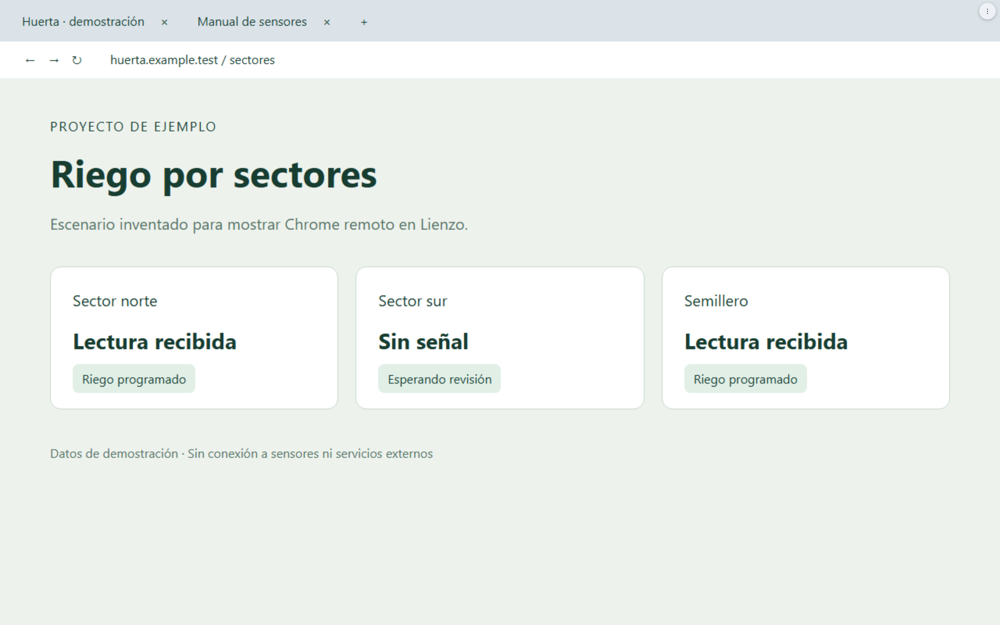
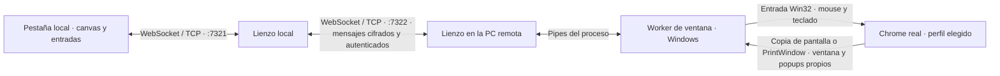

# Chrome remoto

[Volver al README](../README.md)

**Desde 0.6.11:** la ventana completa manda menos datos (en LAN simulada, 26 cuadros por segundo y 11 MB cada
30 s contra 16–19 y 44–53 MB); si la PC de Chrome se bloquea, el visor pasa solo a «Vista por pestañas» en la
pestaña activa y vuelve al desbloquear, salvo que el modo se haya elegido a mano; y las pestañas se agrupan por
perfil de Chrome (lo lee del AppUserModelID de cada ventana de Windows).

**Traer descargas:** clic derecho sobre la tarjeta de una PC en la tira superior del tablero →
**Traer descargas…**. Muestra los 30 archivos terminados más recientes de su carpeta Descargas,
con fecha, tamaño y si el mismo nombre ya existe en esta PC. Elegí los archivos y tocá
**Traer seleccionados**. Los repetidos requieren elegir **Sobrescribir y traer** o
**Saltear existentes** antes de iniciar. Si cambia un archivo local durante la copia, se conserva
y se informa el conflicto. El destino es la carpeta Descargas de la PC donde abriste el tablero.

Ambas PCs deben tener esta versión. La carpeta se detecta mediante la ubicación de Descargas del
usuario de Windows, sin adivinar su nombre. Si falta el permiso en `copy_roots`, el botón
**Habilitar carpeta Descargas** autoriza únicamente esa carpeta en ambas PCs y conserva el resto
de la configuración. La lista y el contenido viajan por el canal cifrado de pares. No hace falta
que Chrome siga abierto para traer archivos ya descargados. Los temporales se omiten; cada bloque
se verifica y se publica el archivo al finalizar. La transferencia continúa al cerrar el diálogo,
pero no se reanuda automáticamente después de reiniciar Lienzo.

El enlace **Chrome remoto** del encabezado abre `/chrome` en una pestaña nueva del navegador.
Elegí una PC. **Chrome real · ventana completa** muestra su ventana de Chrome dentro de esa
pestaña: sus pestañas, barra de direcciones, menús y avisos. Los controles de Lienzo quedan en
el menú **⋮**, para dejar espacio al navegador; también podés usar pantalla completa.
Las páginas, el teclado y el mouse se ejecutan en la PC elegida. La PC debe estar encendida y con
Lienzo abierto; perder la conexión no abre un Chrome sustituto en otra máquina.

En Windows, la vista de ventana completa recuerda el perfil elegido para cada PC. Al entrar,
conecta con una ventana existente; si no hay ninguna, abre automáticamente el perfil recordado
o el primero disponible. **Abrir perfil** permite elegir otro, por ejemplo el del trabajo. Este modo
controla la sesión gráfica de esa PC y no requiere habilitar la depuración remota de Chrome.
Cerrar la vista deja Chrome abierto.

Los menús y popups propios de Chrome se incluyen dentro del área de la ventana compartida;
los que sobresalen de ese borde quedan recortados. El cursor remoto transmite las formas
habituales, como mano sobre enlaces y cursor de texto. En pantalla táctil, tocar hace clic y
arrastrar desplaza la página. El mouse y el teclado físicos también permiten controlar la ventana.
La imagen y las entradas usan un canal persistente; los movimientos se agrupan para enviar la
posición más reciente y las actualizaciones de imagen omiten regiones que no cambiaron.

**Transporte y latencia.** La vista de ventana completa usa WebSocket (RFC 6455) sobre **TCP**;
no usa UDP ni RDP. La conexión se abre con un Upgrade HTTP y permanece abierta: no hace un
pedido HTTP por cada movimiento o cuadro. Entre PCs, cada mensaje va cifrado y autenticado
con un contador por sentido. UDP se usa para descubrir PCs en la LAN, no para transmitir Chrome.

Si la ventana está visible y sin tapar, el worker copia lo ya compuesto en pantalla; si no, usa
`PrintWindow` (que en cada cuadro hacía parpadear la ventana real). Compara capturas y envía PNG
binario de la región modificada, o un cuadro completo cuando corresponde. Si no cambia la imagen,
no la reenvía. El visor confirma los cuadros dibujados
y hay como máximo **dos sin confirmar**, para acotar la cola. Los movimientos consecutivos
conservan la posición más reciente y se despachan con `requestAnimationFrame`; clics y teclas
no esperan la siguiente captura. La entrada despierta la captura en reposo y una vista oculta
pausa las imágenes. Imagen y entrada comparten el transporte TCP: la congestión todavía puede
agregar demora. No hay una medición publicada de latencia de extremo a extremo ni una garantía
de equivalencia con RDP.

**Portapapeles en la ventana completa.** Pegar en el visor manda el texto local (hasta 16.000
caracteres) al portapapeles de la PC remota y le teclea Ctrl+V a Chrome; sólo se pega texto. Una
copia hecha allá se avisa sin mostrar su contenido y recién viaja al tocar «Copiar acá», y sólo si
esa ventana de Chrome estaba al frente; si cambió la ventana activa, no se lee el portapapeles.

**Vista por pestañas** ofrece otra forma de navegar, con pestañas, dirección/búsqueda,
atrás, adelante y recarga propios de Lienzo. Usa la depuración remota de Chrome. Las dos PCs
necesitan esta versión de Lienzo; la que ejecuta Chrome necesita **Chrome instalado y
Node.js 24 o posterior**. Para usar sus perfiles existentes (el personal, el del trabajo), elegí uno
y tocá **Abrir perfil en esa PC**. En el Chrome de destino, versión 144 o posterior, abrí
`chrome://inspect/#remote-debugging` y tildá «Allow remote debugging»: se hace frente a esa PC.
Tocá **Conectar Chrome abierto** en Lienzo y aceptá el aviso
de Chrome en el destino. Chrome decide qué perfil comparte; con varios abiertos usa su perfil
predeterminado. Abrir un perfil desde Lienzo no garantiza que Chrome comparta ese perfil.
**Desconectar** deja Chrome y sus pestañas abiertos. No se copian cookies ni se modifican sus
preferencias para habilitar la conexión. La autorización inicial requiere interacción en el
Chrome de destino; no se promete que este modo funcione sin monitor o sesión gráfica activa.

Con ambas PCs actualizadas, esta vista usa un canal WebSocket persistente y la misma conexión
CDP ya autorizada. Chrome empuja los cuadros con `Page.startScreencast` a la resolución real del
dispositivo (JPEG 90): 25 cuadros por segundo contra 9,5 del sondeo anterior, y la primera imagen de
una pestaña nueva en 24 ms contra 948. Mientras la página se desplaza los cuadros salen a 1x y
calidad 80, y la nitidez vuelve a los 300 ms de quedar quieta: en un scroll denso, de 20 a 25,5
cuadros por segundo y de 11 a 4,9 MB/s. Una pestaña oculta o minimizada pasa a capturas espaciadas,
con un aviso.

La captura y la entrada se procesan por separado. El movimiento del mouse no espera la confirmación
de Chrome: gana el último (con la ventana tapada cada move tardaba 5 s y terminaba en 504; ahora,
10 a 28 ms). Clic, tecla y rueda siguen confirmados y nunca se reenvían, tampoco tras un error o una
desconexión. Una pestaña admite un visor a la vez; una reconexión rápida de la interfaz espera a que
el visor anterior la suelte. Al cambiar de pestaña o tamaño se descartan cuadros de la selección
anterior. Una pestaña restaurada que Chrome no había cargado contesta 409 enseguida, en vez de un
504 a los 8 s.

Mientras un visor mira una pestaña, la pestaña toma el tamaño CSS del visor con su densidad de
píxeles real, así la vista no tiene franjas negras. Vuelve a su tamaño cuando el visor cambia de
pestaña, cierra, no llega a abrir o pierde el socket. Sólo el dueño del stream ajusta la pestaña
(en 0.5.5, dos visores ajustando por turnos hacían parpadear la ventana real), la interfaz manda un
tamaño por gesto después de 300 ms y repetir un tamaño no manda nada. Medido en un Chrome aislado:
605 px de franjas arriba y abajo con un visor de 700×1000 y 477 px a los costados con uno de
1400×520; ahora 0. El ajuste cambia la página también en la ventana real de la otra PC.

Con la PC bloqueada anda sobre el Chrome real si Chrome arrancó con
`--disable-features=CalculateNativeWinOcclusion`. Medido el 2026-10-21: ~14,5 cuadros por segundo
bloqueada contra 21–23 desbloqueada; sin la bandera, 0,3. Chrome 155 ya no la ofrece en
`chrome://flags`: va en los accesos directos de Chrome. Un perfil abierto desde Lienzo con
**Abrir perfil en esa PC** ya la lleva.

La alternativa **Usar un perfil separado de Lienzo → Abrir Chrome** usa un perfil persistente en
`~/.lienzo/chrome-remoto`, en modo headless, sin monitor. **Cerrar Chrome** cierra sólo ese proceso.
Volver al tablero o cerrar la pestaña local conserva el navegador remoto. Se admite abrir hasta
doce pestañas desde Lienzo. El acceso se realiza desde el
tablero local de una PC emparejada, no desde el túnel público del celular.

El canal de peers autentica los pedidos y cifra el contenido y las entradas del navegador. El
puerto de control de Chrome queda en loopback, sin abrir otro puerto en la LAN. No acepta comandos
CDP arbitrarios ni navegación directa a `file:` o `javascript:` en la vista por pestañas. En esa vista,
Ctrl+C copia texto seleccionado y
Ctrl+V pega texto; los diálogos JavaScript se contestan dentro de la vista. Transmite imagen, no
audio. Las descargas se deshabilitan sólo en el perfil separado;
en Chrome habitual se conserva su configuración y los archivos quedan en la PC remota. Carga de archivos, ventanas
del sistema y extensiones no están integradas en la vista por pestañas.

Prueba aislada propuesta: `py tests/browser_smoke.py` (Chrome real, perfil temporal y web local,
sin cuentas ni sitios externos). UI con fixtures: `chrome.spec.ts`. Su ejecución y las limitaciones
de la corrida se registran con `pruebas-agenticas`; no se fijan baselines automáticamente.
